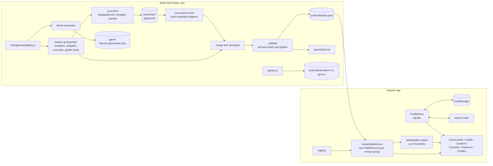

# Poké Guide — Implementation Plan

A companion web app for catching Pokémon, shipped with **Red, Blue and Yellow** first and **built so new games (Crystal, FireRed/LeafGreen, Emerald, …) can be added without rewriting it**.

For each area it lists the Pokémon you can get, in the order you visit the areas, with level ranges, types and how to get each one. It also has a checklist of every Pokémon you can get in that game **without trading with another player**. Progress is saved in `localStorage`, you can keep several named profiles, and each profile can be imported or exported as a string.

- **Stack:** TypeScript, Angular 22 (latest is `@angular/core` 22.1.x, checked 2026-09-12), Angular Material 3
- **Data:** scraped from Bulbapedia when the site is built
- **Hosting:** GitHub Pages, set up in the **last** phase

---

## Table of contents

1. [Decisions](#1-decisions)
2. [Assumptions (correct me if wrong)](#2-assumptions-correct-me-if-wrong)
3. [Bulbapedia research findings](#3-bulbapedia-research-findings)
4. [Multi-game architecture](#4-multi-game-architecture)
5. [Architecture overview](#5-architecture-overview)
6. [Repository layout](#6-repository-layout)
7. [Data pipeline (build-time scraper)](#7-data-pipeline-build-time-scraper)
8. [Domain model (shared TypeScript types)](#8-domain-model-shared-typescript-types)
9. [Obtainability rules (what goes on the checklist)](#9-obtainability-rules-what-goes-on-the-checklist)
10. [Location order (walkthrough order)](#10-location-order-walkthrough-order)
11. [Angular application](#11-angular-application)
12. [Profiles, persistence and import/export](#12-profiles-persistence-and-importexport)
13. [UI/UX specification (desktop and mobile)](#13-uiux-specification-desktop-and-mobile)
14. [Testing strategy](#14-testing-strategy)
15. [Attribution and legal notes](#15-attribution-and-legal-notes)
16. [Phased milestones](#16-phased-milestones)
17. [Deployment to GitHub Pages (final phase)](#17-deployment-to-github-pages-final-phase)
18. [Risks and mitigations](#18-risks-and-mitigations)
19. [Adding a new game — checklist and roadmap](#19-adding-a-new-game--checklist-and-roadmap)

---

## 1. Decisions

| Topic | Decision |
|---|---|
| Games | Ship with **Red, Blue and Yellow** (international English versions; Japanese Red/Green and Japanese Blue are ignored). The architecture is **game-agnostic** (§4), and adding a game means adding data configuration, not changing the app. **Gold, Silver and Crystal** follow in Phase 10 (§16, decided 2026-09-23). |
| Data source | A **Node/TypeScript script scrapes Bulbapedia when the site is built** through the MediaWiki API. It writes static JSON per *version group* that is committed to the repo. Hand-curated **override files** cover data that isn't in a parseable template. The app never calls Bulbapedia at runtime. |
| What counts toward the checklist | Wild encounters, **evolutions** (except those that need a trade), **in-game NPC trades**, **gifts, prizes and fossils**, **static encounters and legendaries**. For later generations, **breeding** also counts where the game has a Day Care. If you must pick one option (starter, fossil, Hitmonlee/Hitmonchan), the options are shown as an *either/or group*. Transfers from other games or Pal Park count as trading, so they're excluded. |
| Catch status | **Only two states: caught or not caught.** No "seen" state. |
| Extra Pokémon info | Shown **wherever Bulbapedia has it**: the **catch rate** and **base stats** for the game's generation, **shiny odds and rules** per generation, and **IV/DV rules** per generation (plus fixed or guaranteed values on specific encounters). Two tools use this data: a **catch-chance calculator** and an **IV/DV calculator** (§13.11). |
| Profiles | **Several named profiles.** Each profile is tied to one game and can be switched, renamed, deleted, imported and exported. |
| UI | **Angular Material 3.** Light and dark mode, with the accent color matching the game, generated from the game registry. |
| License | **No license file** is added to the repo. The Bulbapedia attribution is still shown in the app (§15). |
| Git | **The user handles all git operations manually** (init, commits, branches, remotes, pushing, creating the GitHub repo). Tooling never runs git commands, and the Angular scaffold uses `--skip-git`. "Committed" files in this plan are generated, and the user commits them. |
| Deployment | GitHub Pages publishing (workflows, base href, repo setup) is the **last phase** (§17). Until then everything runs and is tested locally. |
| Versioning | **SemVer from the user's side**, starting at **1.0.0** for the first public deploy. Only release tags `vX.Y.Z` deploy (§17.1, decided 2026-10-13). |
| Framework conventions | Standalone components, signals, zoneless change detection, the built-in control flow (`@if`, `@for`), `OnPush`, lazy-loaded routes, and the `@angular/build` application builder. **Modern Angular 22 APIs only** (user rule, 2026-09-15): `input()`/`output()`/`model()`, `inject()`, functional guards, and **Signal Forms** (`@angular/forms/signals`) — never `FormsModule`/`ngModel` or reactive forms. RxJS is used only where an Angular API returns an Observable, consumed with `firstValueFrom` or `toSignal`. See `CLAUDE.md` for the full list. |

---

## 2. Assumptions (correct me if wrong)

1. **The UI is English only.** Pokémon and location names come from English Bulbapedia. Strings stay in templates, and i18n isn't planned.
2. **Sprites are the in-game sprites of the selected game** (Red/Blue sprites for Red/Blue, Yellow sprites for Yellow), not modern artwork.
3. **The checklist scope is every species the game can give you without trading**, numbered by **National Dex**. A regional Pokédex order can be offered as a sort option for games that have one.
4. **Level ranges and encounter rates are shown.** Catch rates, base stats, shiny odds and IV/DV information are **also included** wherever Bulbapedia documents them (§3.5, §7.11, §13.11).
5. **Each profile is one playthrough of one game.** There's no combined "Red + Blue" profile.
6. **Only one copy of each species is tracked** (not a "living dex" with every evolution stage kept separately).
7. The app name is **"Poké Guide"**.

---

## 3. Bulbapedia research findings

I checked these against live Bulbapedia pages while writing the plan. They drive the parser design.

### 3.1 API access
- Raw wikitext: `https://bulbapedia.bulbagarden.net/w/index.php?title=<Page>&action=raw`
- Batched API (preferred): `https://bulbapedia.bulbagarden.net/w/api.php?action=query&prop=revisions&rvprop=content|ids|timestamp&rvslots=main&redirects=1&titles=A|B|C&format=json&formatversion=2`. It accepts up to 50 titles per request.
- The API returns `access-control-allow-origin: *` and works without logging in.
- Content license from `meta=siteinfo&siprop=rightsinfo`: **CC BY-NC-SA 2.5**.
- Some titles redirect or are disambiguation pages. For example, `Pokémon Lab` redirects to `Pokémon Research Lab`, `Pokémon Mansion` is a disambiguation page, and the real page is `Pokémon Mansion (Kanto)`. **Always pass `redirects=1` and store the resolved title.**
- Per-game location categories exist, e.g. `Category:Red,_Blue_and_Yellow_locations`. We use them to check that each game's ordered location config doesn't miss anything.

### 3.2 Location pages are shared across generations
One location page (e.g. `Kanto Route 1`) holds the encounter tables for **every game that visits it**, split by generation heading. Each generation uses its own row template:

```wikitext
==Pokémon==
===Generation I===
{{catch/header|land|no}}
{{catch/entry1|016|Pidgey|yes|yes|no|Grass|2-5|50%|type1=Normal|type2=Flying}}
{{catch/entry1|016|Pidgey|no|no|yes|Grass|2-7|70%|type1=Normal|type2=Flying}}
{{catch/div|land|Attacking Oak}}
{{catch/entry1|025|Pikachu|no|no|yes|Special|5|One|type1=Electric}}
{{catch/footer|land}}

===Generation II===
{{catch/header|land|yes}}
{{catch/entry2|016|Pidgey|yes|yes|yes|Grass|2-4|45%|45%|0%|type1=normal|type2=flying|11=k}}

===Generation III===
{{catch/entryfl|016|Pidgey|yes|yes|Grass|2-5|50%|type1=normal|type2=flying}}

===Generation IV===
{{catch/entryhs|016|Pidgey|yes|yes|Grass|2-4|45%|45%|0%|type1=normal|type2=flying}}
```

Observed row templates and what they tell us about the adapters we'll need:

| Template | Games (version flag columns) | Differences |
|---|---|---|
| `catch/entry1` | Red, Blue, Yellow | One rate |
| `catch/entry2` | Gold, Silver, Crystal | **Morning / day / night rates** (3 columns) |
| `catch/entryfl` | FireRed, LeafGreen | One rate |
| `catch/entryhs` | HeartGold, SoulSilver | Morning/day/night rates, `all=` shorthand, Headbutt groups, swarms, radio |
| `catch/entrype` | Let's Go Pikachu/Eevee | Includes "Sky" encounters |
| *(Hoenn pages, to confirm when adding the game)* | Ruby, Sapphire, Emerald | Likely `catch/entry3` |

So the parser must be **template-adapter based**: each version group declares which generation heading and which row template to read.

### 3.3 `catch/entry1` (Red/Blue/Yellow) positional parameters

| # | Meaning | Examples |
|---|---|---|
| 1 | National Dex number (3 digits) | `016` |
| 2 | Species name | `Pidgey`, `Nidoran♀`, `Farfetch'd`, `Mr. Mime` |
| 3 | In **Red** | `yes` / `no` |
| 4 | In **Blue** | `yes` / `no` |
| 5 | In **Yellow** | `yes` / `no` |
| 6 | Method / location column | `Grass`, `Cave`, `Building`, `Surf`, `Fish Old`, `Fish Good`, `Fish Super`, `Gift`, `Special`, **or a floor label** such as `3F` or `1F` (Pokémon Tower, Pokémon Mansion) |
| 7 | Levels | `5`, `2-5`, `8, 10, 12`, `27, 32`, `2-3, 6` |
| 8 | Rate or quantity | `50%`, `One`, `Purchase for {{PDollar}}500`, `{{tt|One|If Pikachu's friendship is 147 or higher.}}` |
| named | Types, as they were in that generation | `type1=Normal`, `type2=Flying`. Capitalization varies. |

What varies from page to page:
- The template name is capitalized on some pages and not others (`catch/entry1` vs `Catch/entry1`). Match case-insensitively.
- **Sub-areas** come either from headings (`====1F====`, `====Center Area====` in Mt. Moon, Seafoam, Safari Zone, Cerulean Cave) or from `catch/div` labels (`{{Catch/div|ghost|3F}}` in Pokémon Tower, `{{catch/div|ruins|1F}}` in the Mansion).
- **Method groups** come from `catch/div` labels: `Surfing`, `Fishing`, `Gift Pokémon`, `Special`. Labels can contain markup such as `<br><small>…</small>` or `{{color2|…}}`, which must be stripped.
- **Heading depth varies.** Most pages use `==Pokémon==` then `===Generation I===`. Silph Co. uses `===Pokémon===` then `====Generation I====`. The parser must measure heading levels relative to each other.
- Two templates can sit on the same line with no newline between them (seen on Cinnabar Island). Tokenize by brace matching, not by line.
- Notes can appear as prose before the table (for example "Prior to Yellow, no wild Pokémon appear while surfing here"). Keep them as optional location notes.
- HTML comments with pret disassembly references appear inside the section. Strip comments before parsing.
- Some rows repeat the same species with different levels or rates per version, and some split a version across several rows (for example Route 12 Goldeen, Good Rod vs Super Rod). Merge by *(species, method, sub-area, game)*.

### 3.4 Data that is NOT in `catch/entry*` tables (needs special parsers or overrides)
| Data | Where it lives (Red/Blue/Yellow) | Approach |
|---|---|---|
| Game Corner prizes | `Celadon Game Corner` → `===Prize corner===` → `====Generation I====` → `{{shop|…Pokémon Red…}}` / `{{shopmon|Abra|063|180|lv=9}}` | A reusable **shop parser** (Game Corner prizes also exist in Gen II–IV) that keeps only shops matching the version group's games. It skips Japanese "Pocket Monsters Blue". |
| In-game trades | `In-game trade` → `===Generation I===` → wikitable rows with `{{rt|2|Kanto}}` / `{{MSP/3|063|Abra}}` | A reusable **trade-table parser**, keyed by generation section, with a curated fallback file |
| Static encounters and legendaries (Snorlax ×2, Articuno, Zapdos, Moltres, Mewtwo, Power Plant Voltorb/Electrode) | Prose or infoboxes. For example, Victory Road says *"A Moltres appears on 2F on the first visit"*. Route 16's Gen I table has no Snorlax. | **Curated override file** that links to the source page |
| Fossils (Helix/Dome choice at Mt. Moon, Old Amber at Pewter Museum, revived at Cinnabar Lab) | `Mt. Moon`, `Pewter Museum of Science`, `Cinnabar Lab`. The museum page only has a Gen IV table. | **Curated override** |
| Starters (Red/Blue choice, Yellow Pikachu), Eevee (Celadon Condominiums), Hitmonlee/Hitmonchan (Fighting Dojo) | Various pages. The starters are in Professor Oak's Laboratory's Gen I table (`First partner Pokémon` group), not Pallet Town's. | Use the table when one exists (e.g. Yellow Bulbasaur in Cerulean City, Charmander on Route 24, Lapras in Silph Co., Magikarp purchase on Route 4). Otherwise use a **curated override**. |
| Species list and types | `List of Pokémon by National Pokédex number` → `{{ndex|0001|Bulbasaur|Grass|Poison}}` | Parse. **These are current types**, so apply the per-generation type history in §7.5. |
| Evolutions | Each species page's evolution box | Parse, then check against a curated table per version group (§7.6) |
| Sprites | `archives.bulbagarden.net` (e.g. `File:Spr_1y_025.png` for Yellow) | Download when building, per sprite set |
| Visit order | `Walkthrough:Pokémon Red and Blue` and `Walkthrough:Pokémon Yellow` contents tables (16 parts plus post-game). Other games have `Walkthrough:Pokémon <Game>` pages. | Hand-written ordered config per game (§10), checked against the walkthrough part lists |
| Items per location (§7.13) | Location page `Items` section (`==Items==`, or `===Items===` under `In the core series games`) → `{{Itemlist\|<sprite key>\|<where>\|R=yes\|B=yes\|Y=yes\|display=…}}`, 203 Gen I rows over 37 of the 57 original locations, plus Oak's Lab, Sea Cottage and Celadon Department Store. Gym leader TMs and the Department Store rooftop drink TMs are only on the walkthrough part pages, which use the same `{{itemlist}}` rows. | **Item-list parser** plus curated overrides for missing items and unstated prerequisites; walkthrough rows are a cross-check (warnings) |

### 3.5 Catch rates, base stats, shiny odds and IVs (confirmed available)
| Data | Where | Format and caveats |
|---|---|---|
| Catch rate | Species page infobox: `\|catchrate=45` (Bulbasaur), `\|catchrate=190` (Pikachu) | Current value. Older values are in `List of Pokémon by catch rate` as table rows like `\| class="r" \| 127 \|\| 90 prior to Generation III` (Raticate). **Caveat:** in Gen I the catch rate byte also decides the held item when traded to Gen II (the page's "Generation I held items" section), so Yellow notes need care. Checked in the pret disassembly: Kadabra's "96" is written **after** capture and the partner Pikachu's "163" is a gift, so both are notes only. Dragonair "27 in Pokémon Yellow" and Dragonite "9" are Yellow's base-stats catch rates, which capture **does** use (`species[].catchRateByGame`, §7.11). |
| Base stats | Species page `===Stats===` → `====Base stats====` → `{{Stats\|HP=…\|Attack=…\|Defense=…\|SpAtk=…\|SpDef=…\|Speed=…\|Special=…}}` | `Special` is the single Gen I stat. When stats changed, headings such as `======Generations I-V======` and `======Generation VI onward======` come before each `{{Stats}}` (seen on Pikachu). `{{Stats/PE}}` (Let's Go partner forms) is ignored. |
| Capture formula | `Catch rate` page, one section per generation (`Capture method (Generation I)`, `(Generation II)`, `(Generation III-IV)`, V, VI, VII, Let's Go) | Gen I is documented as a step-by-step algorithm: random ranges per ball (255/200/150), status thresholds (25/12), the HP factor `f`, and shake counts. The page also covers Safari Zone bait and rocks. **Exact** probabilities can be computed by enumerating the random numbers. |
| Shiny | `Shiny Pokémon` → `Determining Shininess` and the `Shiny Pokémon rates` table | **Gen I has no Shiny Pokémon in-game.** DVs decide Shininess when a Pokémon is moved to Gen II, or to Pokémon Bank from the Virtual Console games (Poké Transporter 1.3 or later): Defense, Speed and Special all 10, and Attack in {2, 3, 6, 7, 10, 11, 14, 15}, about 1 in 8192. Gen II–V: 1/8192 (Gen II eggs from a Shiny parent: 1/64). Gen VI+: 1/4096, plus method-specific rates. |
| IVs / DVs | `Individual values` → `Generation I and II`, `Generation III onward`, `Influence`, `NPC's Pokémon` | Gen I–II: DVs 0–15 for Attack, Defense, Speed and Special, with the HP DV derived from them. Gen III+: IVs 0–31 for all six stats. Fixed values in later games: Gen II in-game trades, the Red Gyarados (always Shiny). Gen I in-game trade DVs are random (per `In-game trade`). |
| Stat formula | `Stat` page (to fetch in Phase 1) | Needed for the IV/DV calculator |

---

## 4. Multi-game architecture

### 4.1 Concepts
| Concept | Meaning | Examples |
|---|---|---|
| **Generation** | Sets the type chart, which mechanics exist and the maximum National Dex number | 1 (151 species, 15 types), 2 (251, adds Dark and Steel), 3 (386) |
| **Region** | Where locations live. One game can visit several regions. | Kanto, Johto (Crystal visits both), Hoenn, Sevii Islands (FireRed/LeafGreen) |
| **Version group** | Games that share almost all their data and Bulbapedia template. It's **the unit of data files and pipeline config.** | `rby` = Red, Blue, Yellow · `gsc` = Gold, Silver, Crystal · `rse` = Ruby, Sapphire, Emerald · `frlg` = FireRed, LeafGreen |
| **Game** | The thing a profile is tied to. It has its own encounters, visit order, accent color and sprites. | `red`, `yellow`, `crystal`, `firered`, `emerald` |

Remakes (FireRed/LeafGreen) reuse **Kanto location ids and pages**, but they're a separate version group. They get their own location list, template adapter and visit order.

### 4.2 Game registry (single source of truth, framework-free)
`src/app/core/games/registry.ts`, imported by both the app and the pipeline:

```ts
export interface GameDefinition {
  id: GameId;                       // 'red' | 'blue' | 'yellow' | 'crystal' | ...
  codecId: number;                  // stable numeric id for export codes; NEVER reused or changed
  name: string;                     // 'Pokémon Crystal'
  shortName: string;                // 'Crystal'
  versionGroupId: VersionGroupId;   // 'rby'
  generation: number;               // 1
  regions: RegionId[];              // ['kanto']
  releaseOrder: number;             // for the game picker
  releaseYear: number;              // North American release, shown in the game picker
  nationalDexMax: number;           // 151
  regionalDex?: { id: string; name: string };   // e.g. Johto Pokédex, for sort options
  accent: { seed: string };         // hex; full M3 palettes are generated from it (§13.1)
  spriteSetId: string;              // 'gen1-rb'
  status: 'available' | 'planned';  // 'planned' games show as "Coming Soon" and only open in dev builds
}

export interface VersionGroupDefinition {
  id: VersionGroupId;               // 'rby'
  games: GameId[];
  generation: number;
  dataFile: string;                 // 'data/rby.json' (relative URL)
  features: GenerationFeatures;
  mechanicsId: string;              // 'gen1' → core/mechanics/gen1.ts (§4.5)
}

export interface GenerationFeatures {
  breeding: boolean;                // Day Care eggs (Gen II+)
  timeOfDay: boolean;               // morning/day/night encounter slots (Gen II, IV)
  dayOfWeek: boolean;               // Gen II/IV weekday events
  seasons: boolean;                 // Gen V
  heldItems: boolean;               // Gen II+
  friendship: boolean;              // Gen II+ friendship evolutions
  abilities: boolean;               // Gen III+ (not shown for now, reserved)
}
```

Codec ids are fixed: red 1, blue 2, yellow 3, gold 4, silver 5, crystal 6, ruby 7, sapphire 8, emerald 9, firered 10, leafgreen 11, diamond 12, pearl 13, platinum 14, heartgold 15, soulsilver 16, black 17, white 18, black2 19, white2 20 (gold 4 and silver 5 were registered in Phase 10; ruby 7, sapphire 8 and Gen IV–V on 2026-10-13).

The initial registry contained `red`, `blue` and `yellow` as `available`. Every game up to Black 2 and White 2 is registered, the ones without data as `planned` (2026-10-13): version groups `rse`, `frlg`, `dppt`, `hgss`, `bw` and `b2w2`, with best-guess `GenerationFeatures` that each game's phase confirms. The game picker lists `planned` games as "Coming Soon" cards that don't open; in dev builds (`PLANNED_GAMES_OPEN`, from `isDevMode()`) they open so they can be built and checked. A release never makes a work-in-progress game playable. Each one has a plan under `docs/plans/` (§19.2).

### 4.3 What is generic and what is game-specific
| Generic (written once) | Game or version-group specific (config and data) |
|---|---|
| Wikitext tokenizer, section finder, markup, level and rate parsers | Which generation heading and **row template adapter** to read |
| MediaWiki client, cache, sprite downloader, validator, diff report | Ordered location list, walkthrough pages, ignored category pages |
| Shop and trade-table parsers (parameterized by generation section and game names) | Overrides: statics, gifts, choices, fossils, unlocks, patches, event-only species |
| Obtainability engine (evolution closure, breeding, trades, exclusive groups, unlocks) | Evolution graph for that generation, breeding rules, trade-required evolutions |
| Profile store, export codec, all UI pages, method and condition display | Accent color, sprite file pattern, golden assertions |
| Type badges for all 18 types | The type list per generation, and species type history |

Rule: **no `if (game === 'yellow')` in app code.** Anything that differs between games is data, or a capability flag in `GenerationFeatures`.

### 4.4 Extensible vocabularies
- **Encounter methods** are a registry (`core/games/methods.ts`), not a switch statement. Each entry is `{ id, label, icon, category: 'wild' | 'fishing' | 'water' | 'gift' | 'trade' | 'static' | 'prize' | 'fossil' | 'egg', sectionOrder }`. Red/Blue/Yellow use: `walk-grass`, `walk-cave`, `walk-building`, `surf`, `fish-old`, `fish-good`, `fish-super`, `gift`, `starter`, `purchase`, `prize`, `trade`, `static`, `fossil`, `special`. Later games add entries such as `headbutt`, `rock-smash`, `swarm`, `dive`, `bug-contest`, `radio`, `egg`, `roaming`.
- **Encounter conditions** are a tagged union (§8) covering time of day, day of week, swarm, season, story flag and more. The UI renders any known condition generically, e.g. as a chip or a column set.
- **Evolution triggers** carry a `requiresTrade` boolean. The obtainability engine only looks at that flag, so new triggers (held item plus trade, friendship, location-based, …) need no engine changes.

### 4.5 Generation mechanics (catch formula, shiny rules, IV system)
Some things are rules for a whole generation rather than data about one encounter. They live in framework-free **strategy modules**, `src/app/core/mechanics/gen1.ts`, `gen2.ts`, …, which a version group selects through `mechanicsId`:

```ts
export type StatId = 'hp' | 'atk' | 'def' | 'spa' | 'spd' | 'spe' | 'spc';   // 'spc' = Gen I Special

export interface GenerationMechanics {
  id: string;                                   // 'gen1'
  stats: StatId[];                              // gen1: hp, atk, def, spc, spe · gen3+: hp, atk, def, spa, spd, spe
  statLabels: Record<string, string>;           // 'spc' → 'Special', so the tool pages need no stat table
  ivSystem: { kind: 'dv'; max: 15; hpDerived: true; label: 'DV' }
          | { kind: 'iv'; max: 31; hpDerived: false; label: 'IV' };
  shiny: ShinyRules;                            // in-game shinies?, base odds, special cases, "shiny if transferred" rule
  capture: CaptureFormula;
  statValue(input: StatInput): number;          // base, iv/dv, level, effort (stat exp / EVs), nature?
  effortFromDefeat(baseStats): Partial<Record<StatId, number>>;  // gen1–2: the defeated species' base stats
  effortLabel: string;                          // 'Stat Exp' · 'EVs'
  effortDescription: string;                    // one sentence under the base-stat table
  dvTraits?: DvTraitDef[];                      // gen2: gender, Shiny, Unown letter (decided by the DVs)
  solveIvs(baseStats, observations, { species, traits }?): IvSolution;
                                                // possible values per stat and trait, count, contradiction,
                                                // shiny verdict
  sources: { label: string; url: string; site?: string }[];  // shown in the UI; site defaults to Bulbapedia
}

export interface CaptureFormula {
  balls: BallDef[];                             // gen1: Poké, Great, Ultra, Safari, Master; `limited` for
                                                // Safari/Park Balls (odds before they run out)
  statuses: StatusDef[];                        // gen1: none · sleep/freeze · paralysis/burn/poison
  inputs?: CaptureInputDef[];                   // select | number | boolean, optionally tied to balls:
                                                // gen1 Safari Game (bait / rock, Safari Ball only);
                                                // gen2 player's level (Level), hooked (Lure), your Pokémon (Love)
  reportsShakes: boolean;                       // whether the break-free animation carries information
  shakesNote?: string;
  compute(input: CaptureInput): CaptureResult;  // input: catch rate, ball, status, HP, wild level, target species
                                                // (dex, weight, gender ratio), game, input values.
                                                // result: exact P(catch) per throw, expected throws, throws for
                                                // 50/90/99 %, shakes on failure (if reported), notes (game bugs)
}
```

**Gen I module** (`core/mechanics/gen1.ts`, written in Phase 6 from `Catch rate` rev 4612204, `Stat` rev 4605719 and
`Individual values` rev 4625391):
- `gen1Capture` counts the outcomes of the algorithm's two random draws instead of using Bulbapedia's
  "approximate probability", which overshoots above a catch rate of 230 (Poké), 175 (Great) or 125 (Ultra).
  Inside those ranges the two agree exactly, which is asserted in `gen1.spec.ts`.
- The Safari Game halves (floor) or doubles the catch rate, saturating at 255 — confirmed against pret
  `pokered/engine/items/item_effects.asm` (`srl [hl]`, `add a` with the `$ff` carry branch).
- `gen1SolveDvs` enumerates all 16⁴ DV sets against every reading, deriving the HP DV from the other four,
  and reports `'yes' | 'no' | 'possible'` for the Generation II Shiny condition.

**Gen II module** (`core/mechanics/gen2.ts`, Phase 10 Stage G, from the same Bulbapedia pages plus `Poké Ball`
rev 4631237 and `Shiny Pokémon` rev 4624856, every step checked against pret pokecrystal 5beda23 / pokegold 62388c7):
- Capture: the ball multiplies the catch rate (8-bit, saturating), then the HP step
  `max(⌊(3·HPmax − 2·HPcur) × rate / 3·HPmax⌋, 1)` (both products quartered when 3·HPmax > 255), then +10 for
  sleep or freeze only (the paralysis/burn/poison bonus is skipped by a bug); P = (a + 1) / 256. Shakes are random,
  so `reportsShakes` is off.
- Apricorn balls with their bugs: Level Ball (2×/4×/8× below the player's level, ½ and ¼ of it; **skips the HP and
  status steps**, from pret, not stated on the cached Bulbapedia pages), Lure Ball (3× when hooked), Moon Ball
  (never boosts), Friend Ball (1×), Fast Ball (4× for Magnemite, Grimer, Tangela only), Heavy Ball (−20/0/+20/+30/+40
  by weight; Crystal reads +40 for Kadabra, Tauros and Sunflora), Love Ball (8× for the same species and **same**
  gender), Park Ball (1.5×, 20 per contest).
- DVs: the shared `dv.ts` solver (also used by Gen I) with the Special DV driving Sp. Atk and Sp. Def, and the
  summary-screen traits: gender (`16·Atk + Spe ≤` the ratio byte), Shiny (1/8192; 1/64 for an egg from a Shiny
  parent) and Unown's letter.
- Fixed DVs are data: the Gen II in-game trades (read from the `In-game trade` table's DV column, `dvOrder`,
  with the HP DV cross-checked) and the Red Gyarados (`OverrideEncounter.ivs` and `shiny: 'guaranteed'`).

Games that break their generation's rules (e.g. Let's Go) get their own module. Exceptions for single encounters (fixed IVs, Shiny-locked, guaranteed Shiny, a different catch rate) are **data** on the encounter slot (§8), not code.

---

## 5. Architecture overview



The domain types, the game registry and the obtainability engine sit in `src/app/core/domain` and `src/app/core/games`, which have **no Angular dependencies**. The Node pipeline and the app both import them, so they share one source of truth.

---

## 6. Repository layout

```
poke-guide/
├─ IMPLEMENTATION_PLAN.md
├─ README.md
├─ angular.json, package.json, .node-version
├─ tsconfig.json / tsconfig.app.json / tsconfig.spec.json / tsconfig.scripts.json
├─ scripts/
│  ├─ theme/generate-game-themes.ts    # registry accent seeds → M3 token CSS per game
│  └─ data/
│     ├─ build.ts                      # CLI: --group rby | --all, --refresh, --offline
│     ├─ core/
│     │  ├─ mediawiki-client.ts        # batching, throttle, retries, maxlag, redirects
│     │  ├─ cache.ts                   # raw wikitext cache keyed by title + revid
│     │  ├─ wikitext.ts                # comments/refs stripping, brace-matching tokenizer, heading tree
│     │  ├─ sections.ts                # ==Pokémon== → "Generation N", relative heading levels
│     │  ├─ markup.ts                  # strip <br>, <small>, {{tt}}, {{color2}}, [[links]], {{PDollar}}
│     │  ├─ levels.ts, rate.ts
│     │  ├─ encounter-walker.ts        # walks a gen section: sub-areas, divs, rows → adapter
│     │  ├─ merge.ts                   # rows → Location/SubArea/Encounter, per-game slots
│     │  ├─ species.ts                 # ndex list parser and type history application
│     │  ├─ type-history.ts            # per-generation type changes (Fairy retcon, Magnemite Steel, …)
│     │  ├─ evolutions.ts              # evolution box parser (diff source only)
│     │  ├─ species-pages.ts           # infobox catchrate, {{Stats}} with generation-range headings
│     │  ├─ catch-rate-history.ts      # "List of Pokémon by catch rate" notes → per-generation values
│     │  ├─ shop.ts                    # prize/shop parser, parameterized
│     │  ├─ trades.ts                  # in-game trade table parser, parameterized
│     │  ├─ sprites.ts                 # imageinfo resolution and download per sprite set
│     │  ├─ validate.ts                # zod schemas and generic sanity rules
│     │  └─ report.ts                  # markdown diff vs previous build
│     ├─ adapters/
│     │  ├─ catch-template-adapter.ts  # interface
│     │  ├─ entry1.ts                  # Red/Blue/Yellow
│     │  └─ entry2.ts                  # Gold/Silver/Crystal — extensibility spike, tests only at first (§16 Phase 1)
│     ├─ version-groups/
│     │  ├─ index.ts                   # map of VersionGroupConfig by id
│     │  └─ rby/
│     │     ├─ config.ts               # VersionGroupConfig (§7.1)
│     │     ├─ locations.ts            # per-game ordered locations (§10)
│     │     ├─ overrides/
│     │     │  ├─ static-encounters.ts
│     │     │  ├─ gifts-and-choices.ts # starters, fossils, Hitmon choice, Eevee
│     │     │  ├─ evolutions.ts        # authoritative Gen I graph
│     │     │  ├─ trades.ts            # fallback and diff for parsed trades
│     │     │  ├─ unlocks.ts
│     │     │  ├─ event-only.ts        # Mew
│     │     │  └─ patches.ts
│     │     ├─ golden.spec.ts          # hand-verified facts
│     │     └─ __fixtures__/           # committed raw wikitext samples
│     └─ reports/                      # generated per-group markdown reports
├─ public/
│  ├─ data/rby.json                    # GENERATED, committed (later: gsc.json, frlg.json, rse.json…)
│  ├─ sprites/gen1-rb/001.png …        # GENERATED, committed
│  ├─ sprites/gen1-y/001.png …
│  └─ icons/, manifest.webmanifest
└─ src/
   ├─ index.html, main.ts, styles.scss
   ├─ theme/  game-themes.generated.scss, type-colors.generated.scss (all 18 types; base M3 theme is in styles.scss)
   └─ app/
      ├─ app.config.ts, app.routes.ts, app.ts
      ├─ core/
      │  ├─ games/                     # FRAMEWORK-FREE: registry.ts, methods.ts, conditions.ts, types.ts, pokemon-types.ts
      │  ├─ routing/  game.guard.ts, current-game.service.ts
      │  ├─ domain/                    # FRAMEWORK-FREE: models.ts, obtainability.ts, levels.ts, export-codec.ts
      │  ├─ mechanics/                 # FRAMEWORK-FREE: index.ts, gen1.ts (capture formula, DVs, shiny rules, stat formula)
      │  ├─ data/game-data.service.ts
      │  ├─ storage/  storage.service.ts, migrations.ts
      │  ├─ profiles/profile.store.ts
      │  ├─ settings/settings.store.ts
      │  └─ layout/breakpoints.ts
      ├─ shared/
      │  ├─ components/ sprite, type-badge, level-range, rate, condition-chips, catch-toggle,
      │  │              progress-ring, method-icon, exclusive-group-chip, game-chip, empty-state
      │  └─ pipes/ dex-number.pipe.ts, method-label.pipe.ts
      └─ features/
         ├─ games/           # game picker (grouped by generation)
         ├─ onboarding/
         ├─ guide/
         ├─ location/
         ├─ checklist/
         ├─ pokemon/
         ├─ tools/           # catch-chance and IV/DV calculators
         ├─ profiles/
         ├─ settings/
         └─ about/
```

---

## 7. Data pipeline (build-time scraper)

### 7.1 Version-group config contract
```ts
export interface VersionGroupConfig {
  id: VersionGroupId;                          // 'rby'
  generationHeading: string;                   // 'Generation I' (section on location pages)
  catchAdapters: CatchTemplateAdapter[];       // [entry1Adapter]
  locationCategory: string;                    // 'Category:Red, Blue and Yellow locations'
  ignoredCategoryPages: string[];
  locations: LocationConfig[];                 // page, id, kind, region, per-game {part, order}, itemsOnly? (§7.13),
                                               // requires? (unlocks needed to reach it, added to its encounters and items)
  itemGameFlags: Record<string, GameId[]>;     // { R: ['red'], B: ['blue'], Y: ['yellow'] } on {{Itemlist}} rows (§7.13)
  itemAliases: Record<string, string>;         // spelling variants → item name ('Elixer' → 'Elixir')
  walkthroughs: Partial<Record<GameId, string>>; // 'Walkthrough:Pokémon Red and Blue'
  speciesRange: [number, number];              // [1, 151]
  extraParsers: ExtraParser[];                 // shop (prizes), trades
  overrides: {
    encounters: EncounterOverrides;            // encounters (statics), patches, exclusiveGroups, eventOnly,
                                               // requiresOtherGame (§7.7, §9)
    evolutions: EvolutionEdge[];
    breeding?: BreedingRules;                  // gen 2+
    unlocks: Unlock[];
    items: ItemOverrides;                      // add, requires, patch, remove, requirementPhrases, choiceGroups, walkthroughAccepted, walkthroughGames (§7.13)
  };
  spriteSets: Record<string, { filePattern: string; stillFrame?: true }>; // keyed by registry spriteSetId: 'gen1-y' → 'Spr_1y_{dex3}.png'
                                               // stillFrame: keep an animated PNG's first frame (Crystal, Phase 10)
  // Phase 10 adds: overrides.breeding (BreedingRules), regionalDexPage (fills species.regionalDex),
  // itemNoteRules (fruit/Apricorn trees → itemNotes)
}

export interface CatchTemplateAdapter {
  templateNames: string[];                     // ['catch/entry1'] (matched case-insensitively)
  parseRow(t: TemplateCall, ctx: WalkContext): RawEncounterRow;   // → per-game slots
  // Gets the whole row (a `Gift` with a price is a purchase) and the context (a floor label maps to a walking
  // method by location kind). Throws AdapterError on unknown methods.
  normalizeMethod(row: RawEncounterRow, ctx: WalkContext): { method: EncounterMethodId; subArea?: string; requires?: string[] };
}
```

### 7.2 npm scripts
```jsonc
"data:build":    "tsx scripts/data/build.ts",               // uses cache, fetches only what's missing
"data:build:all":"tsx scripts/data/build.ts --all",         // same as data:build (kept for compatibility)
"data:refresh":  "tsx scripts/data/build.ts --refresh",
"data:offline":  "tsx scripts/data/build.ts --offline",     // fixtures/cache only, category from the snapshot
// Every script covers every version group (Phase 10); `npm run data:build -- --group gsc` narrows it.
// build.ts also accepts --dry-run (print the report, write nothing). Files are never written when there are errors.
// Golden tests read the generated public/data files, so rebuild after pipeline changes.
"data:sprites":  "tsx scripts/data/sprites.ts",             // skips files whose SHA-1 matches the archive (stillFrame sets: the manifest)
"data:validate": "tsx scripts/data/validate.ts",            // committed data files vs. the build checks and item registry; no network
"theme:games":   "tsx scripts/theme/generate-game-themes.ts"
```
Dev dependencies: `tsx`, `zod`, `@material/material-color-utilities`, `fast-check`.

### 7.3 Fetching (being polite to Bulbapedia)
- Use the **batched API** (`titles=` up to 50 per request). Red/Blue/Yellow is about 70 location pages, 151 species pages and 5 list pages, so roughly **6–8 requests** in total.
- Send a descriptive `User-Agent` (`poke-guide-data-builder/0.1 (+https://github.com/mihmin98/poke-guide; …)`, in `mediawiki-client.ts`).
- Send `maxlag=5`, wait a random 2–5 s between requests, and retry with exponential backoff on 429/5xx or `maxlag` errors, respecting `Retry-After`. Any other error status (such as a 403 challenge) fails at once, without retrying.
- Show progress while fetching: a one-line bar with the request count, a countdown to the next request and an ETA on a terminal, or one plain line per request elsewhere (`core/progress.ts`).
- Cache files are `scripts/data/cache/raw/<title>.json`, holding `{title, resolvedTitle, revid, timestamp, wikitext}`. The cache is gitignored and shared between version groups, since one location page serves several generations.
- Record each page's `revid` in the output under `sources[]`, for attribution links and for reviewing what changed between refreshes.

### 7.4 Parsing pipeline
1. **Tokenizer** (`core/wikitext.ts`):
   - Strip `<!-- … -->` comments and `<ref>…</ref>` / `<ref … />`.
   - Build a heading tree from lines matching `^(={2,6})\s*(.+?)\s*\1\s*$`.
   - Walk `{{`/`}}` with a depth counter, also tracking `[[…]]` depth, and split parameters on `|` only at depth 0. Output `TemplateCall { name (lowercased), positional[], named{}, offset }`.
2. **Section finder** (`core/sections.ts`): find the heading titled `Pokémon` (level L), then its child heading equal to `config.generationHeading` (level > L). Take its range up to the next heading at level ≤ its own.
3. **Encounter walker** (`core/encounter-walker.ts`), which goes through templates and deeper headings in order:
   - A deeper heading (`====1F====`, `====Area 1 - East====`) sets `subArea` and clears `divLabel`.
   - `catch/header` clears `divLabel`.
   - `catch/div|<style>|<label>`: clean the label. A floor pattern (`^B?\d+F$`) sets `subArea`. Anything else sets `divLabel`.
   - A template matching an adapter's `templateNames` is passed to `adapter.parseRow` and `adapter.normalizeMethod`.
   - Other `catch/entry*` templates inside the section are logged as warnings.
4. **The `entry1` adapter's method mapping:**

| Raw method | Normalized | `requires` |
|---|---|---|
| `Grass` | `walk-grass` | – |
| `Cave`, `Building`, `B?\dF` (the floor also becomes the sub-area) | `walk-cave` / `walk-building` | – |
| `Surf` | `surf` | `surf` |
| `Fish Old` / `Fish Good` / `Fish Super` | `fish-old` / `fish-good` / `fish-super` | `old-rod` / `good-rod` / `super-rod` |
| `Gift` with "Purchase for" in the rate | `purchase` | – |
| `Gift` | `gift` | – |
| `Special` | `special` (e.g. Yellow's "Attacking Oak" Pikachu becomes `starter` via a patch) | – |

5. **Levels** (`core/levels.ts`): split on `,`, parse each token as `n` or `a-b`, and produce `{ min, max, values? }`. `values` is kept only for lists that aren't a continuous range.
6. **Rates** (`core/rate.ts`):
   - `NN%` becomes `{kind:'percent', value}`.
   - `One` becomes `{kind:'once'}`.
   - `Purchase for {{PDollar}}500` becomes `{kind:'price', value:500}`.
   - `{{tt|X|note}}` becomes X plus a `note`.
   - Adapters for time-of-day generations produce **one slot per condition**, e.g. `entry2` gives morning, day and night slots.
7. **Merge** (`core/merge.ts`): group rows by `(locationId, subArea, method, dex)` and build `games: { red?: EncounterSlot[], … }`. Split rows for the same game and condition have their levels unioned and their percentages added.
8. **Type check:** compare row `type1/type2` with the species master data after applying the type history. A mismatch is a warning.

### 7.5 Species master data and type history
- Parse `List of Pokémon by National Pokédex number` into all species (number, name, current types), then take `config.speciesRange`.
- `core/type-history.ts` is a shared, **generation-aware** table: `typesIn(dex, generation)`.
  - Entries needed for Red/Blue/Yellow (Gen I):
    - Clefairy #035 and Clefable #036 → Normal
    - Jigglypuff #039 and Wigglytuff #040 → Normal
    - Mr. Mime #122 → Psychic
    - Magnemite #081 and Magneton #082 → Electric (Steel was added in Gen II)
  - The Gen II–V entries for the rest of the Fairy retcon (e.g. Togepi, Marill, Snubbull, Ralts line) are filled in when those generations are added, and checked against Bulbapedia then.
  - Each data file's `types` list follows the generation: 15 types in Gen I, 17 in Gen II–V, 18 from Gen VI.
- Cross-check every species against the types written in the generation's catch tables. Mismatches fail validation.
- Store a `slug` for URLs (`nidoran-f`, `mr-mime`, `farfetchd`).

### 7.6 Evolutions and breeding
- `overrides/evolutions.ts` is the **authoritative** graph per version group (about 70 edges for Gen I). The evolution boxes parsed from species pages are only used to **diff and warn** (`core/evolution-boxes.ts`).
  - Only the standard boxes are parsed (`Evobox-1/2/3`, `Evobox/1branch2`, `Evobox/2branch2`) under `Game data` → `Evolution data` (sometimes titled `Evolution`). Regional-form stages (`formK`) are skipped.
  - Other layouts (Eevee's `Evobox/Setup` table, `Evobox/Meowth-Alola`) are reported as notes. An override edge missing from the boxes is a warning only when a fully readable page of either species covers it, so Eevee's edges are checked through the Eeveelution pages.
  - The boxes describe the latest games, so a warning can be a real generation difference. Triage warnings instead of copying the boxes into the override.
  - Each edge is `{from, to, trigger, level?, item?, requiresTrade, games?}`.
  - Gen I trade evolutions with `requiresTrade: true`: Kadabra→Alakazam, Machoke→Machamp, Graveler→Golem, Haunter→Gengar.
- Species above `speciesRange` and triggers that didn't exist in that generation are excluded. For example, Pichu, Espeon and Scizor are not in Gen I.
- Breeding (Gen II and later, off for `rby`) uses `BreedingRules { dayCareLocationIds, dittoDex: 132, babyItemRequirements?: {offspring, item}[] }`, plus per-species `eggGroups` and `genderRatio`, to decide whether an egg is obtainable (§9).

### 7.7 Special parsers and overrides for Red/Blue/Yellow
- **Game Corner (`core/shop.ts`, config `prizeShops`):** inside `Prize corner` → `Generation I`, read each `{{shop|<title>}} … {{shopfooter}}` block. Map the title to games through its `{{color2}}` link texts (`Pokémon Red`, `Pokémon Blue`, `Pokémon Yellow`; `All versions` = every game). Shops naming no game of the version group (`Pocket Monsters Blue`) are skipped with a note. Each `{{shopmon|Name|dex|coins|lv=N}}` becomes a walked row with `method: 'prize'`, `rate: {kind:'coins'}`, levels `N` and `requires: ['coin-case']`, merged into the location like table rows. Each `{{shopitem|TM23|3300|C||TM Dragon|Dragon Rage}}` becomes a **location item** (§7.13) instead: `obtain: 'purchase'`, `coins: 3300`, `name: 'TM23 Dragon Rage'` (number plus move, matching the `TM16 Pay Day` convention), `subArea` from the config's `itemSubArea` (`Prize corner`), `where: "Game Corner prize for N Coins"` and `requires: [['coin-case']]`. Prizes in another currency (`{{shopitem|Fresh Water|200}}`, Poké Mart stock) are skipped with a note, keeping §7.13's scope. A configured shop with no section is an error; a found shop replaces the "no Pokémon section" warning.
- **In-game trades (`core/trades.ts`, config `tradePage`):** inside `Generation I`, read the wikitables under the configured child headings (`Pokémon Red and Green (Japan), Pokémon Red and Blue (Western)` → red/blue, `Pokémon Yellow` → yellow). Location comes from the first cell (`{{rt|N|Kanto}}` → `Kanto Route N`, `{{OBP|title|disambiguation}}` → `title (disambiguation)`, or a `[[link]]`) and carries over rowspans. The player gives the 1st `{{MSP/3|dex|Name}}` and gets the 2nd. **A row whose English nickname is `N/A` is a Japanese-only trade and is skipped** (the row background marks the Japanese vs international release, not Red vs Blue). **The location tables already hold every Gen I trade row**, so the trade page is a cross-check: differences either way are warnings, unknown location pages are errors, and matches set `trade.nickname`. No `overrides/trades.ts` fallback is needed for rby.
- **Static encounters**, each with `sourcePage` and `revid`, and verified against the page text in Phase 1:
  - Snorlax: Route 12 and Route 16. Requires the Poké Flute. Two copies are obtainable.
  - Articuno: Seafoam Islands (lowest floor). Moltres: Victory Road. Zapdos: Power Plant. Mewtwo: Cerulean Cave (post-game).
  - Power Plant Voltorb and Electrode that look like item balls.
  - Implemented in `overrides/encounters.ts` (`core/encounter-overrides.ts`): each static is a once-only walked row merged with the location's table rows (so floors such as `B4F` reuse the table's sub-areas). Levels are checked against pret `pokered`/`pokeyellow` (Snorlax 30 ×2 with the Poké Flute; Articuno 50 on B4F with Surf + Strength; Zapdos 50, Voltorb 40, Electrode 43 with Surf; Moltres 50 on 2F with Strength; Mewtwo 70 on B1F after the Hall of Fame). `sourcePage` defaults to the location page. Encounter requirements must be unlocks in every game of the encounter (error).
  - **Not catchable, excluded:** the Pokémon Tower ghost Marowak and glitch Pokémon.
- **Gifts and choices:**
  - **Exclusive group** `rby-starter` = {Bulbasaur, Charmander, Squirtle}, Red/Blue only, Professor Oak's Laboratory (its Gen I table's `First partner Pokémon` rows → method `starter`).
  - Yellow starter: Pikachu, from the same table. Route 1's "Attacking Oak" row describes the same Pikachu, so a patch drops it (open question 10, resolved). Yellow gifts Bulbasaur (Cerulean City), Charmander (Route 24) and Squirtle (Vermilion City, after defeating Lt. Surge; confirmed in its Gen I table). All three come from the tables.
  - **Exclusive group** `mt-moon-fossil` = {Omanyte, Kabuto}. Aerodactyl comes from Old Amber (Pewter Museum). Cinnabar Lab's Gen I table lists the revivals (method column `Helix`/`Dome`/`Amber` → `fossil`), so the encounters are parsed there. The exclusive group, and notes on where each fossil is found, come from overrides.
  - **Exclusive group** `fighting-dojo` = {Hitmonlee, Hitmonchan}.
  - Eevee: Celadon Condominiums. Lapras: Silph Co. (from its table). Magikarp purchase on Route 4 (from its table).
- **Unlocks:**
  - `old-rod` → Vermilion City (Part 6)
  - `good-rod` → Fuchsia City (Part 11)
  - `super-rod` → Route 12 (Part 12)
  - `surf` → Safari Zone (Part 11)
  - `poke-flute` → Pokémon Tower (Part 9)
  - `coin-case` → Celadon City (Part 9)
  - `post-game` → Cerulean Cave (Part 17)

  Unlocks are defined **per game**, so a game where the Super Rod is found somewhere else just uses a different entry.
- **Event-only:** Mew.
- **Patches:** small, documented corrections to walked rows before the merge, keyed by `locationId` and a match on `method` (plus optional `dex` and `label`). `set` changes the method or label, or `'drop'` removes the rows. A patch that matches no row is an error. Each has a `reason` with a Bulbapedia or pret link. rby: Oak's Lab `First partner Pokémon` gifts → `starter`; Route 1 `Attacking Oak` Pikachu dropped.
- **Exclusive groups** name the locations and methods of their members; every member must be found for every game of the group (error), and matching encounters get `exclusiveGroupId`. The 7 pages without a Gen I Pokémon table (Pewter City, S.S. Anne, Pewter Museum, Lavender Town, Underground Path 7–8, Team Rocket Hideout, Saffron City) are `expectEmpty`.

### 7.8 Validation — the build fails on errors
- **Generic errors:**
  - A zod schema mismatch.
  - A species outside `speciesRange`, or an unknown name.
  - A type that doesn't exist in the generation, or a species page whose infobox disagrees with the species list or the catch-rate list.
  - A location page that couldn't be resolved.
  - A slot for a game that isn't in the version group.
  - Unparseable levels in a wild row.
  - A duplicate location id.
  - Encounter rows on a page marked `expectEmpty`.
  - **Every species in `1..nationalDexMax` is neither obtainable nor given a reason** for some game (§9).
- **Generic warnings:**
  - A category page that's missing from the config.
  - A location that has no section for this generation.
  - Encounter-table types that differ from the species types (ignoring order). Species types never come from these tables, and some rows have typos (Vermilion City Tentacool is written as Water only).
  - Differences between the parsed and override evolution graphs.
  - Differences between the parsed and override trades.
- **Golden assertions** (`version-groups/rby/golden.spec.ts`):
  - Route 1: Red has Pidgey Lv 2–5 at 50%; Yellow has Pidgey Lv 2–7 at 70%.
  - Safari Zone Center Area: Scyther is Red-only, Pinsir is Blue-only.
  - Pokémon Tower 3F Gastly is Lv 18–24 in Red/Blue.
  - Silph Co. Lapras is a gift at Lv 15 in all three games.
  - Route 24 Charmander is a Yellow-only gift.
  - Each game has 3 Game Corner Pokémon in each of its left and middle windows.
  - Mew is event-only. Alakazam, Machamp, Golem and Gengar are unobtainable without trading.
- **Report** (`scripts/data/reports/rby.md`, written by `core/report.ts` next to the data files, committed): obtainable counts per game with "max in one save" and counts per unobtainable reason, the unobtainable species with their reasons, added or removed encounters per location versus the previous data file, and all warnings and notes. It has no timestamp, so it only changes when the data does.
- **Implementation** (`core/validate.ts`, run by `build.ts` after assembly; its errors stop the write like assembly errors): strict zod schemas for `rby.json` and `rby.pokedex.json` (unknown keys are errors, at most 25 schema messages), then cross-references (registry games, known methods, species, exclusive groups, evolution and learnset species, duplicate location ids), then `buildChecklist` for every game. A species whose reason is the `not-in-game` fallback is an error.

### 7.9 Output format — `public/data/<versionGroup>.json`
One file per version group, written as compact JSON (the example below is pretty-printed for reading). The first `rby.json` build (without shop, trade and static overrides) is 244 KB, 21 KB gzipped; `rby.pokedex.json` is 203 KB, 27 KB gzipped. It's loaded lazily, only when one of its games is opened.

```jsonc
{
  "schemaVersion": 1,
  "versionGroupId": "rby",
  "generation": 1,
  "games": ["red", "blue", "yellow"],
  "builtAt": "2026-09-12T20:00:00Z",
  "types": ["normal", "fire", "water", "..."],
  "species": [
    { "dex": 1, "name": "Bulbasaur", "slug": "bulbasaur", "types": ["grass", "poison"], "regionalDex": {},
      "catchRate": 45, "baseStats": { "hp": 45, "atk": 49, "def": 49, "spc": 65, "spe": 45 } }
  ],
  "evolutions": [
    { "from": 1, "to": 2, "trigger": "level", "level": 16, "requiresTrade": false },
    { "from": 64, "to": 65, "trigger": "trade", "requiresTrade": true }
  ],
  "breeding": null,
  "walkthroughs": {
    "red":    [ { "part": 1, "title": "Introduction, Pallet Town", "region": "kanto" } ],
    "yellow": [ { "part": 1, "title": "Introduction, Pallet Town", "region": "kanto" } ]
  },
  "unlocks": { "red": [ { "id": "super-rod", "label": "Super Rod", "locationId": "route-12", "part": 12 } ] },
  "exclusiveGroups": [
    { "id": "mt-moon-fossil", "label": "Choose one fossil", "games": ["red", "blue", "yellow"], "members": [138, 140] }
  ],
  "eventOnly": [151],
  "locations": [
    {
      "id": "route-1",
      "name": "Route 1",
      "region": "kanto",
      "kind": "route",
      "placement": { "red": { "part": 2, "order": 200 }, "blue": { "part": 2, "order": 200 }, "yellow": { "part": 2, "order": 200 } },
      "source": { "title": "Kanto Route 1", "revid": 1234567 },
      "notes": [],
      "subAreas": [
        {
          "id": "main",
          "name": null,
          "encounters": [
            {
              "dex": 16,
              "method": "walk-grass",
              "games": {
                "red":    [ { "levels": { "min": 2, "max": 5 }, "rate": { "kind": "percent", "value": 50 } } ],
                "blue":   [ { "levels": { "min": 2, "max": 5 }, "rate": { "kind": "percent", "value": 50 } } ],
                "yellow": [ { "levels": { "min": 2, "max": 7 }, "rate": { "kind": "percent", "value": 70 } } ]
              }
            }
          ]
        }
      ]
    }
  ],
  "sources": [ { "title": "Kanto Route 1", "revid": 1234567, "url": "https://bulbapedia.bulbagarden.net/wiki/Kanto_Route_1" } ]
}
```
A Gold/Silver/Crystal slot would look like `{ "levels": {…}, "rate": {"kind":"percent","value":45}, "conditions": [{"kind":"time","value":"morning"}] }`. No schema change is needed.

### 7.10 Sprites
- Resolve URLs with `archives.bulbagarden.net/w/api.php?action=query&titles=File:…&prop=imageinfo&iiprop=url|sha1` (the same polite `MediaWikiClient`, pointed at `ARCHIVES_API`). That returns `archives.bulbagarden.net/media/upload/…` URLs. Downloads go through the same throttle and User-Agent (`client.download`).
- Sprite sets for Red/Blue/Yellow: `gen1-rb` (`Spr_1b_{dex3}.png`, confirmed 2026-09-13; `Spr_1g` is Japanese Green) and `gen1-y` (`Spr_1y_{dex3}.png`). All are 56×56 PNGs. Later sets (e.g. Crystal `Spr_2c_…`, Emerald `Spr_3e_…`) are configured per version group.
- Config: `spriteSets: Record<setId, { filePattern }>`, keyed by the registry's `spriteSetId` (the registry already maps game → set, so the config doesn't repeat it). A game whose set has no pattern is an error.
- `scripts/data/sprites.ts` (CLI) + `core/sprites.ts` (`spriteJobs`, `syncSprites`): a local file whose SHA-1 matches the archive is skipped, so there is no cache or `--refresh`. Every download is checked against the SHA-1; missing files and mismatches exit 1.
- Save them to `public/sprites/<setId>/<dex3>.png` and commit them. Render with `image-rendering: pixelated`. Fallback: a Poké Ball SVG.

### 7.11 Catch rates, base stats and extra encounter details
- **Species pages** are already fetched for evolutions. `core/species-pages.ts` also extracts:
  - `catchrate=` from the infobox (the current value).
  - Base stats: every `{{Stats}}` under `====Base stats====`, paired with the nearest preceding generation-range heading (`Generations I-V`, `Generation VI onward`, `Generation I`, …), which is parsed into `[fromGen, toGen]`. No heading means all generations. Gen I uses `Special`; Gen II+ uses `SpAtk`/`SpDef`. `{{Stats/PE}}` and blocks for alternate forms are ignored for now.
- **Catch-rate history** (`core/catch-rate-history.ts`): parse the `List of Pokémon by catch rate` rows (dex, value, note).
  - Notes matching `^(\d+) prior to Generation ([IVX]+)$` become `{value, untilGeneration}` entries.
  - `N prior to <game>` (e.g. `5 prior to ORAS`) is applied the same way when the game is in a later generation than the version group.
  - `N in <games>` / `Always succeeds in <games>` notes that only name games outside the version group (`90 in XD: Gale of Darkness`, `20 in Legends: Z-A`) are ignored. Game names resolve through the registry plus a small table of non-registry games; an unknown name needs a classification.
  - Any other non-empty note, including notes naming one of the version group's games (e.g. "27 in Pokémon Yellow"), is **never applied automatically**. It must be classified in `version-groups/<id>/overrides/catch-rate-notes.ts` as `note-only` or `override` (with optional `games`, and a `reason` with a source). **The build fails on unclassified notes and on classifications that match no note**, so new edge cases can't slip in silently.
  - Only default-form rows are used (Minior has only form rows; resolve it when Gen VII is added).
- The output uses the version group's generation: `species[].catchRate` and `species[].baseStats` are the values **for that generation**, with an optional `catchRateNote`. A game whose capture uses a different value gets `species[].catchRateByGame` (Yellow Dragonair 27, Dragonite 9; verified in the pret disassembly, see `PROGRESS.md` open question 15).
- **Per-encounter extras** on `EncounterSlot` (§8), filled from overrides or trade tables only when a source states them:
  - `ivs`: `{kind:'fixed', values}` (e.g. Gen II in-game trades, Red Gyarados) or `{kind:'min-perfect', count}` (Gen VI+ legendaries). If absent, IVs are random per the generation's rules.
  - `shiny`: `'locked' | 'guaranteed'`. If absent, the generation's base odds apply.
  - `catchRateOverride`, for the rare encounter that differs from its species, with a source link.
  - In Red/Blue/Yellow all DVs are random (the `In-game trade` page confirms this for trades), so no extras are expected. The fields exist for later games.
- **Golden assertions:**
  - Catch rates: Bulbasaur 45, Pikachu 190, Mewtwo 3, Raticate **90** in Gen I (127 later).
  - Base stats: Pikachu's Gen I Defense is 30 and Special is 50; Bulbasaur's Gen I Special is 65.
  - Dragonair's catch rate is 45 in Red/Blue and 27 in Yellow (`catchRateByGame`); Kadabra stays 100 (its "96" note is note-only).
- **Stat formula:** fetch the `Stat` page in Phase 1 and implement `statFormula` per generation from it (Gen I–II: DVs and stat experience; Gen III+: IVs, EVs, natures), with its worked examples as tests.

### 7.12 Pokédex details: moves, learnsets, entries (added 2026-09-13)
- **Species extras** from the infobox (`core/species-pages.ts`), written to `species[]` in the main data file:
  - `category` (current spelling, without " Pokémon"; the old all-caps Gen I–II spellings such as `POISONMOTH` are not used), `heightM`, `weightKg`.
  - `baseExp`: `oldexp` for Gen I–IV, `expyield` from Gen V.
  - `growthRate` from `lv100exp` (800,000 fast · 1,000,000 medium-fast · 1,059,860 medium-slow · 1,250,000 slow · 600,000 erratic · 1,640,000 fluctuating).
  - `evYield` only from Gen III (`evhp`…`evsp`). In Gen I–II the stat experience gained equals the defeated species' base stats, so nothing is stored; `core/mechanics` explains it. IVs/DVs are random per the generation's rules (§3.5), so they are not per-species data either.
- **Base stats** accept `{{Stats}}`, `{{Base Stats}}` and `{{BaseStats with RBY}}`, and range headings spelled `Generations I-V`, `Generation I to V`, `Generation VI onward(s)`. Form headings other than the species name (Mega, regional, Partner) are skipped.
- **Pokédex entries:** `{{Dex/Entry1|v=…}}` / `{{Dex/Entry2|v=…|v2=…}}` inside `{{Dex/Gen/N|gen=<roman>}}`, mapped to games by registry `shortName` (Stadium entries are dropped).
- **Learnsets** (`core/learnsets.ts`) come from `<Name> (Pokémon)/Generation <roman> learnset` subpages (151 extra pages, about 4 batched requests). The species page itself only has the latest generation's learnset.
  - Kept sections: *By leveling up* (`learnlist/levelN` single column, or `learnlist/level<roman>` with one level column per header label, e.g. `RGB|Y`), *By TM/HM* (`learnlist/tmN`), *By a prior Evolution* (`learnlist/prevoN`: up to two previous stages, an optional `RB`/`Y` game flag).
  - Ignored: transfer-only moves, events, Stadium tutoring, Move Reminder lists. `N/A` means the game can't learn it by level; footnote markers such as `42*` are stripped.
  - Column labels and game flags map to games through `learnsetLevelColumns` in the version-group config (`rby`: `RGB`/`RB` → red+blue, `Y` → yellow).
- **Moves:** learnset rows carry the move's type, power, accuracy and PP **as of that generation** (Gen I Bite is Normal), so `collectMoves` builds the version group's move list from them, with ids slugged from the generation's spelling (`ThunderShock` → `thundershock`). Conflicting data between pages, or two moves on one TM, fail the build. The Gen I physical/special split by type is a mechanics rule, not stored.
- **Output:** `public/data/<versionGroup>.pokedex.json` (`PokedexData` in §8: `moves`, `learnsets` and `entries` keyed by National Dex number, plus `sources`). It is a separate file so the guide and checklist don't download about 4,000 learnset rows; it's loaded lazily by Pokémon detail.
- **Golden assertions (§7.12):** Pikachu learns Thunder Wave at 9 in Red/Blue and 8 in Yellow, and Tail Whip only in Yellow; Gen I has 55 TM/HM moves and 164 learnable moves; Mew learns every TM/HM; Pikachu's Gen I base experience is 82.

### 7.13 Items per area (requested and designed 2026-09-13)
- **Goal:** each location lists the items found there for the selected game and each item's **prerequisites** beyond reaching the location in walkthrough order (Cut, Surf, Strength, a key item, an event).
  - Included: visible pickups, hidden items, gifts, rewards, trainer drops, choices, Game Corner coins, and the **Game Corner TM prizes bought with coins** (`obtain: 'purchase'`, parsed by `core/shop.ts`, see §7.7). Fake item balls become a location note.
  - Out of scope (user choice): Poké Mart stock and temporary items (Safari Balls).
  - Items were informational at first. **Phase 9** lets profiles tick items as picked up, keyed by the item numbers below.
- **Research (Red/Blue/Yellow):**
  - **Where:** location pages have an `Items` section (`==Items==`, or `===Items===` under `In the core series games` / `In the games`). It holds `{{Itemlist|<sprite key>|<where>|<game flags>|display=…}}` rows between `{{itlisth}}` and `{{itlistfoot}}`. There are 203 Gen I rows (flags `R`/`B`/`Y`) over 37 of the 57 original locations; the other 20 only have rows for later games (checked).
  - **Names:** the first parameter is a sprite key (`TM Water`, `Old Rod III`, `Card Key III`). The item name is `display=` when present (`{{TM|12|Water Gun}}`, `[[Potion]] ×2`, `10 {{OBP|Coin|Game Corner}}s`), otherwise the key. `{{Itemlist/N|item1|…|itemN|<where>|flags}}` exists but has no Gen I rows.
  - **`<where>` text:** it can hold `*` bullets (one spot each, e.g. Mt. Moon `Potion ×2`), `''(hidden)''` (62 rows), a floor prefix (`B2F, …`), `{{sup/1|RBY}}` notes, and `(requires …)`.
  - **Stated prerequisites:** only 18 rows have a `(requires …)`: Cut ×7, Surf ×4, Lift Key ×3, Strength, "Cut or Surf", "defeating the Jr. Trainer♂ or Cut", and a Cut/Chop Down mix.
  - **Sub-headings:** sub-areas (`===Ship===`, `====2F====`), version splits (`===Pokémon Red and Blue===` / `===Pokémon Yellow===` in Cerulean Cave, where the flags already say it), or `===Fake items===` (Power Plant Voltorb ×6 and Electrode ×2, item `None`). `{{main|X#Items}}` points to another page.
  - **Game differences:** Red/Blue and Yellow differ only in Cerulean Cave and one Viridian Forest spot (Antidote vs Potion).
  - **Walkthroughs:** the part pages (`Walkthrough:Pokémon Red and Blue/Part N`, `Walkthrough:Pokémon Yellow/Part N`) use the same rows (212 for Red/Blue, 215 for Yellow). Compared with the location pages, they add the 8 Gym leader TMs (Gym pages are ignored locations) and the 3 Department Store rooftop drink TMs (a game-column wikitable on the store page). They disagree on Cerulean Cave in Yellow and on Route 15's Exp. All (the location page says Exp. Share).
- **Parser (`core/items.ts`, a generic walker for the Gen I–IV `Itemlist` rows):**
  1. Find the `Items` section (path `Items`, or `In the core series games` / `In the games` → `Items`). An `itemsOnly` location without one is an error; other locations without Gen I rows are fine.
  2. Walk headings and `itemlist` / `itemlist/N` rows in order.
     - Headings that name a game (matched through the registry) don't change the sub-area.
     - `Fake items` rows become `itemNotes`.
     - `{{main|…}}` becomes a note-level issue.
  3. Games come from the flag keys through `config.itemGameFlags`. Rows without one of the version group's flags are skipped (this covers the Japanese `JR`/`JG` flags).
  4. **Item name:** render `display` (`{{TM|28|Dig}}` → `TM28 Dig`, `{{HM|01|Cut}}` → `HM01 Cut`, coins → `Coins`) and strip `×N`. Without `display`, use the key minus a trailing roman sprite suffix. Spelling variants (`Elixer`) go through `config.itemAliases`, and the id is `slugify(name)`.
  5. **Spots:** split `<where>` on top-level `*` bullets.
     - Each spot gets `hidden` and a floor (`^(B?\d+F|Rooftop)`). The floor becomes the sub-area when no heading gives one.
     - It keeps plain text without the `(requires …)`, `(hidden)` and other-game `{{sup}}` markers.
     - Quantity: `×N` is split one per spot when N equals the spot count, or applied to a single spot; anything else is a warning.
  6. **`obtain`:** ordered English rules on the plain text, matching the rest of the pipeline:
     - `choice`: `choice between`.
     - `drop`: `dropped by`.
     - `reward`: `reward`, `after defeating`, `for defeating`.
     - `gift`: `received from`, `obtained from`, `gift from`, or a leading `From`.
     - Otherwise `pickup`.
     - Hidden items are always `pickup` (a hidden coin stack "two squares east from the Gym guide" is not a gift). "after defeating" wins over "from", so Gym TMs and Oak's Poké Balls (after the optional rival battle) are `reward`.
  7. **Prerequisites:** `(requires A or B)` / `(requires A and B)`.
     - `{{m|Cut}}` → `cut`; `[[Lift Key]]` / `{{ka|Card Key}}` → `lift-key` / `card-key`.
     - Any other term (e.g. `defeating {{tc|Camper|Jr. Trainer♂}}`) must be mapped in `overrides/items.ts` → `requirementPhrases`, or the build **fails**.
     - "after …" / "for giving …" clauses stay in `where`.
     - A leading article is dropped ("requires the {{ka|Card Key}}" on walkthroughs).
  8. Rows whose text says "cannot be kept" (Safari Balls) are skipped. A `None` row displayed as a Pokémon (`{{p|Voltorb}} ×6`) is a fake item note even without a `Fake items` heading (walkthroughs).
- **Prerequisite vocabulary:** prerequisite ids **are unlock ids** (§7.7). Encounters and items share one list, and the location page can say where each prerequisite is obtained.
  - `Unlock` gains `kind: 'move' | 'key-item' | 'badge' | 'story'`. `move` is an HM field move and includes the badge needed to use it.
  - Every id used by an item or encounter must exist in that game's `unlocks`, or the build fails. Unlocks are in `version-groups/<id>/overrides/unlocks.ts`; `part` is the walkthrough part where the unlock is obtained, and `locationId` must be a configured location.
  - Red/Blue/Yellow adds at least `cut`, `strength`, `flash`, `lift-key`, `card-key`, `secret-key`, `silph-scope`, `ss-ticket` and `bicycle` to the §7.7 list.
- **Overrides (`version-groups/rby/overrides/items.ts`):** each has a source page, a revid and a reason. An override that matches nothing is an error.
  - `add`:
    - Gym leader TMs on their city (`subArea: 'Gym'`, sourced from the walkthrough parts). Viridian Gym's TM27 gets `fromPart: 14`.
    - The rooftop TMs on Celadon Department Store (`gift`, "give her a Fresh Water / Soda Pop / Lemonade").
  - `requires`: unstated gates, matched by `(locationId, itemId, subArea)`, e.g. Silph Co. rooms behind Card Key doors. Curated from the walkthrough text and checked against the pret disassembly maps. Without `itemId` it covers every item of `subArea` (Mt. Mortar's 2F behind Surf and Waterfall, added 2026-09-26).
  - `patch`: corrects fields (name, quantity, games, where, obtain, `fromPart`) of exactly one parsed item; a new name changes the id. Route 15 `Exp. Share` → `Exp. All` (pret `Route15Gate2F.asm`). A patch that matches ≠ 1 item or changes nothing is an error.
  - `remove` (added 2026-09-26): drops exactly one parsed item, for a duplicate another location page also lists (Moomoo Farm repeats Route 39's) or one the international games don't have (the Virtual Console GS Ball, the Japanese-only Egg Ticket).
  - `walkthroughAccepted`: item/game differences that are expected: quantities by default (Oak's 5 Poké Balls), or with `difference: 'requirements'` the requirements a walkthrough states wrongly. `walkthroughGames`: a walkthrough part page whose rows carry wrong game flags (Yellow Part 3). Walkthrough rows whose text starts "Loaned" (Safari Balls) are skipped like "cannot be kept".
  - Additions and requirement overrides name a `sourcePage`; the build fetches it and records its revid (in the item's `source` and in `sources`).
  - `requirementPhrases`: non-standard `(requires …)` terms → unlock ids.
  - `choiceGroups`: Mt. Moon Helix/Dome Fossil → the `mt-moon-fossil` exclusive group id.
- **New locations** (§10): Professor Oak's Laboratory (Part 1), Sea Cottage (Part 5) and Celadon Department Store (Part 9).
  - `LocationConfig.itemsOnly` skips the encounter walk and the "no Generation I section" warning (Sea Cottage, Celadon Department Store).
  - Oak's Lab's Gen I table is walked and provides the starters.
- **Walkthrough cross-check (`core/location-items.ts`):** parse the `{{itemlist}}` rows of each game's walkthrough parts (34 pages, one batched request).
  - Compare each item's **total quantity per game** with the location data, and report walkthrough requirements that no location item with that id has. Differences are **warnings**, triaged in `PROGRESS.md` until `reports/rby.md` exists.
  - A walkthrough row repeated with the same item and text in a later part counts once: the Gold/Silver walkthrough repeats a revisited area's rows (Dark Cave in Parts 3, 7 and 13). Walkthrough rows matching `itemNoteRules` are left out, like the location rows that become notes.
  - Totals are compared, not parts (changed 2026-09-13): the walkthrough groups some places in other parts (Route 2's east side in Part 7, the Pewter Museum's Old Amber in Part 3). A per-part diff gave 41 placement-only warnings.
  - The first rby build has 13 item warnings: Potion, Revive and Poké Ball counts, Yellow's Viridian Forest Antidote, Safari Balls (excluded on purpose), and Exp. All vs Exp. Share.
- **Item numbers (Phase 9, decided 2026-09-23):** every item gets a number `no`, unique within the version group and **never reused**. Profiles store ticks as these numbers, and `PKG2` codes carry them as a bitfield, so they are a compatibility contract like `codecId`.
  - The committed registry `scripts/data/version-groups/<id>/item-numbers.json` holds `next` and one entry per live item: `{no, locationId, subArea, itemId, where}`. It is written by the build (not by hand) and staged with the data.
  - `core/item-numbers.ts` matches each build's items against the registry, one `(locationId, subArea, itemId)` group at a time:
    1. Same `where` text: keeps its number.
    2. Otherwise, the leftovers of the group pair up in page order and keep their numbers, with a **warning** per item ("where text changed"), so a Bulbapedia rewording is triaged rather than silent.
    3. Items still unmatched get `next`, `next + 1`, … (a note per new item).
    4. Registry entries still unmatched are an **error**, unless `overrides/items.ts` → `retiredItems` lists the number with a reason; a retired number then leaves the registry for good (`next` never goes down). A retired number that still matches an item is an error too.
  - With no registry file (a new version group), numbers are handed out in location and page order from 1.
- **Output:** in the main `rby.json` as `GameLocation.items` and `GameLocation.itemNotes` (§8). The location page needs them, and they're small: the first build has 230 items, and `rby.json` grew from 247 to 300 KB raw. Walkthrough pages used are added to `sources`.
- **Golden assertions:**
  - Route 12 `TM16 Pay Day` requires `surf`.
  - Team Rocket Hideout `Silph Scope` is a `drop` requiring `lift-key`.
  - Viridian Forest has an Antidote (Red/Blue only) and a Potion (Yellow only) at the same spot.
  - Mt. Moon's `Potion ×2` is two spots, and the Helix/Dome Fossils are a `choice`.
  - Route 25 `TM19 Seismic Toss` requires the Jr. Trainer♂ story unlock or `cut`.
  - Celadon Game Corner has 14 coin entries.
  - Power Plant has an item note for 6 Voltorb and 2 Electrode.
  - Per-game item totals match the report.

### 7.14 Story milestones (requested and designed 2026-10-13, Phase 11)
A per-game checklist of story progress: gyms and badges, major battles, story events, key items and HMs,
story encounters and gifts. **Red/Blue/Yellow first; Gold/Silver/Crystal added 2026-10-13 (Stage E)**. A version
group without milestones leaves `VersionGroupData.milestones` out, and the app hides the feature (no game checks
in app code).
- **Source: a curated list**, `version-groups/<id>/overrides/milestones.ts` (`milestones` and `retired`), in
  walkthrough order, written from the walkthrough part pages. Walkthrough prose isn't structured enough to parse
  events from, but the pages are cross-checked (below). Each entry: `id` (a curated slug), `label`, `kind`
  (`gym` · `battle` · `event` · `key-item` · `encounter` · `gift`), `part` per game (its keys are the games the
  milestone exists in), `locationId`, and optionally `detail`, `badge`, `grants`, `dex`, `optional`.
  - Red/Blue/Yellow: the 8 gyms; the rival battles, Giovanni ×3, the Elite Four and the Champion; story events
    (Oak's Parcel, Bill, Mr. Fuji, Silph Co.); a milestone for each unlock; the static encounters and gifts
    (Snorlax ×2, the legendary birds, Mewtwo, Lapras, Eevee, the Fighting Dojo choice…); Yellow-only entries such as
    the Jessie & James battles.
  - Ordinary trainers are left out: there are hundreds, and they would swamp the list.
  - `dex` links an `encounter`/`gift` milestone to its species. Ticking it never marks the species caught.
- **Numbers (a contract, like item numbers):** each milestone gets a `no`, never reused. Profiles store ticks as
  these numbers and `PKG3` codes carry them (§12.2). `core/milestone-numbers.ts` matches milestones to the committed,
  build-written registry `version-groups/<id>/milestone-numbers.json` (`{versionGroupId, next, milestones: [{no,
  id}]}`) **by `id`**; new ids get `next`, `next + 1`, …. A registered id that's gone is an **error** until
  `retired` lists its number with a reason. Renaming an id therefore means retiring the old number.
- **Checks** (errors unless noted). The cross-references are in `core/validate.ts` (`checkMilestones`), so
  `data:validate` runs them on the committed files too; the walkthrough cross-check is `core/milestones.ts`, from
  `assemble.ts`. `data:validate` also compares the data's numbers with `milestone-numbers.json` both ways.
  - `id` and `no` unique; `locationId` is a configured location placed in each of the milestone's games; each
    `part` is inside that game's walkthrough.
  - Each `grants` id is an unlock of at least one of the milestone's games, and applies in the games that have it
    (changed 2026-10-13 for Crystal's `ho-oh` and `water-stone`, which sit on all-games milestones). Unlocks that
    come from different places per game (the Director's wing or bell) get one milestone per game instead.
  - **Every unlock is granted by exactly one milestone, no later than the
    unlock's part**, so the unlock list (§7.13) and the story list can't drift apart. "No later than" rather than
    "in the same part" (changed 2026-10-13): becoming Champion (Part 16) grants `post-game`, whose part is 17 because
    that's where the post-game content starts.
  - An `encounter`/`gift` milestone with `dex` has an encounter of that species at its location in each of its
    games.
  - Walkthrough cross-check (**warnings**), over the part pages the item cross-check already fetches: every
    badge a part page awards ("awards you the `{{badge|X}}`", or Crystal Part 13's "award the
    `{{badge|Rising}}`"; other mentions, like Part 5's badge table or the Route 23 guards, don't count) needs a `gym` milestone with `badge: X` in that part, and the reverse; a part's
    `{{Party}}` blocks shouldn't outnumber its `gym` and `battle` milestones. Party blocks sit inside other templates
    (a Gym box), and a run of blocks with the same location, prize and sprite (one per starter, or per rival Eevee
    evolution in Yellow) is one battle.
- **Golden assertions (Red/Blue/Yellow):** each game has the 8 gyms with the 8 badges in order; the Elite Four and
  the Champion are in Part 16; Mewtwo is at Cerulean Cave in Part 17; Lapras is at Silph Co.; Yellow has the
  Jessie & James battles and Red/Blue don't.
- **Output:** `VersionGroupData.milestones` in the main data file, in list order, and a "Story milestones" table
  (total, required, optional per game) in `reports/<id>.md`.
- **First build (2026-10-13):** 60 milestones (Red/Blue 52, Yellow 59), 0 errors and no milestone warnings; `rby.json`
  grew from 300 to 320 KB raw.
- **Gold/Silver/Crystal (Stage E, 2026-10-13):** `gsc/overrides/milestones.ts`, 101 milestones (Gold/Silver 92 with
  57 required, Crystal 97 with 59 required). It covers:
  - the 16 gyms, the rival battles, the Team Rocket executives, the Elite Four and Lance;
  - the post-game Kanto story up to Red, which is **required** (user choice);
  - story events, key items and HMs, statics and gifts;
  - Crystal's own entries: Eusine, the Wise Trio, the Clear Bell, the Tin Tower Suicune, Dratini, the Odd Egg.
  Optional extras at the user's request: catching the roaming beasts, the Bug-Catching Contest, the Map and Radio
  Cards, and the four Unown puzzles. A milestone that needs a later field move sits in the part where the move
  arrives (Lapras: Part 8, Surf). Sprout Tower is optional in Gen II, and Strength is required (the Ice Path).
  Indigo Plateau became an `expectEmpty` gsc location in Part 15 to hold the League, and Blaine sits on `route-20`
  (his Gym is in the Seafoam Islands). Goldens: the 16 badges in order, the League in Part 15, Red in Part 28, the
  per-game wings, the Crystal-only list. 0 errors, no milestone warnings, item numbers unchanged.
- **Journey anchors (Phase 18, added 2026-10-15):** the Story and Guide pages interleave milestones and areas in
  one order (§13.13). Milestone list order and location order are both kept, but a milestone whose `locationId`
  is placed in an **earlier** part (a revisit: Flash on Route 2 in Part 7, the Goldenrod Radio Tower in Part 12)
  has no area of its part to sit next to. The optional `after: locationId` says which area of its part it
  follows. Checks (errors, in `checkMilestones`): `after` only on a revisit milestone, and the location it names
  is placed in the milestone's part in every one of its games. Without `after`, a revisit milestone follows the
  previous step. `reports/<id>.md` has a "Journey" section per game for reviewing the result. Adding the field
  changes no milestone number, and the data `schemaVersion` stays 1 (the field is optional).

---

## 8. Domain model (shared TypeScript types)

`src/app/core/domain/models.ts` and `src/app/core/games/*`, with no Angular imports:

```ts
export type GameId = 'red' | 'blue' | 'yellow'
  | 'gold' | 'silver' | 'crystal' | 'ruby' | 'sapphire' | 'emerald' | 'firered' | 'leafgreen';   // extended as games are added
export type VersionGroupId = 'rby' | 'gsc' | 'rse' | 'frlg';
export type RegionId = 'kanto' | 'johto' | 'hoenn' | 'sevii';

export type PokemonType =
  | 'normal' | 'fire' | 'water' | 'electric' | 'grass' | 'ice' | 'fighting' | 'poison' | 'ground'
  | 'flying' | 'psychic' | 'bug' | 'rock' | 'ghost' | 'dragon' | 'dark' | 'steel' | 'fairy';

export type EncounterMethodId = string;                 // validated against core/games/methods.ts

export interface LevelSpec { min: number; max: number; values?: number[] }

export type Rate =
  | { kind: 'percent'; value: number }
  | { kind: 'once' }
  | { kind: 'price'; value: number }                    // in-game currency
  | { kind: 'coins'; value: number }                    // Game Corner
  | { kind: 'unknown'; text: string };

export type EncounterCondition =
  | { kind: 'time'; value: 'morning' | 'day' | 'night' }
  | { kind: 'day-of-week'; value: 'mon' | 'tue' | 'wed' | 'thu' | 'fri' | 'sat' | 'sun' }
  | { kind: 'swarm' }
  | { kind: 'season'; value: 'spring' | 'summer' | 'autumn' | 'winter' }
  | { kind: 'story'; text: string };                    // e.g. "After becoming Champion"

export interface EncounterSlot {
  levels: LevelSpec | null;
  rate: Rate;
  conditions?: EncounterCondition[];
  ivs?: { kind: 'fixed'; values: Partial<Record<StatId, number>> } | { kind: 'min-perfect'; count: number };
  shiny?: 'locked' | 'guaranteed';                      // absent = generation base odds
  catchRateOverride?: number;
  note?: string;
}

export interface Encounter {
  dex: number;
  method: EncounterMethodId;
  games: Partial<Record<GameId, EncounterSlot[]>>;
  requires?: string[];                                  // unlock ids
  exclusiveGroupId?: string;
  trade?: { giveDex: number; nickname?: string };
  label?: string;
  note?: string;
}

export interface SubArea { id: string; name: string | null; encounters: Encounter[] }
export type LocationKind = 'town' | 'route' | 'cave' | 'building' | 'water' | 'special';

export interface GameLocation {
  id: string; name: string; region: RegionId; kind: LocationKind;
  placement: Partial<Record<GameId, { part: number; order: number }>>;  // absent = not in that game
  source: { title: string; revid: number };
  notes: string[];
  subAreas: SubArea[];
  items: LocationItem[];                                // §7.13
  itemNotes: ItemNote[];                                // e.g. fake item balls, Berry trees
}
// A plain string applies to every game of the group; the object names its games (Crystal-only phone gifts).
type ItemNote = string | { text: string; games: GameId[] };

export type ItemObtainMethod = 'pickup' | 'gift' | 'reward' | 'drop' | 'choice' | 'purchase';

export interface LocationItem {
  no: number;                                           // stable per version group, never reused (§7.13); profiles store it
  itemId: string; name: string;                         // name as spelled for the generation: "TM28 Dig", "Coins"
  quantity: number;
  games: GameId[];
  obtain: ItemObtainMethod;
  hidden?: true;
  subArea: string | null;                               // heading or floor ("B4F")
  where: string;                                        // plain text, without the parsed markers
  requires?: string[][];                                // AND of alternatives, unlock ids: [['cut','surf']] = Cut or Surf
  fromPart?: Partial<Record<GameId, number>>;           // reachable only later than the location's part
  choiceGroupId?: string;                               // e.g. 'mt-moon-fossil'
  coins?: number;                                       // price of an `obtain: 'purchase'` Game Corner prize
  source?: { title: string; revid: number };            // only on override items from another page
}

export type StatId = 'hp' | 'atk' | 'def' | 'spa' | 'spd' | 'spe' | 'spc';   // 'spc' = Gen I Special

export interface Species {
  dex: number; name: string; slug: string;
  types: [PokemonType] | [PokemonType, PokemonType];
  regionalDex?: Partial<Record<GameId, number>>;
  catchRate: number;                                    // value for this version group's generation
  catchRateByGame?: Partial<Record<GameId, number>>;    // games whose capture uses another value (Yellow Dragonair 27)
  catchRateNote?: string;                               // e.g. "127 from Generation III"
  baseStats: Partial<Record<StatId, number>>;           // gen1: hp/atk/def/spc/spe · gen2+: hp/atk/def/spa/spd/spe
  eggGroups?: string[]; genderRatio?: number | 'genderless';   // only when breeding feature is on
}

export interface EvolutionEdge {
  from: number; to: number;
  trigger: 'level' | 'item' | 'trade' | 'friendship' | 'other';
  timeOfDay?: 'morning' | 'day' | 'night';             // Phase 10: Espeon (day), Umbreon (night)
  stat?: 'atk>def' | 'atk<def' | 'atk=def';             // Phase 10: Tyrogue
  level?: number; item?: string; heldItem?: string; condition?: string;
  requiresTrade: boolean;
  games?: GameId[];                                     // absent = all games in the group
}

export interface ExclusiveGroup { id: string; label: string; games: GameId[]; members: number[] }
export interface Unlock { id: string; label: string; kind: 'move' | 'key-item' | 'badge' | 'story'; locationId: string; part: number }
export interface WalkthroughPart { part: number; title: string; region: RegionId }

// Phase 11 (§7.14): story milestones.
export type MilestoneKind = 'gym' | 'battle' | 'event' | 'key-item' | 'encounter' | 'gift';
export interface Milestone {
  no: number;                                           // stable per version group, never reused; profiles store it
  id: string;                                           // curated slug, unique in the version group
  label: string;                                        // "Defeat Brock"
  kind: MilestoneKind;
  part: Partial<Record<GameId, number>>;                // keys = the games the milestone exists in
  locationId: string;
  detail?: string;                                      // "Boulder Badge · TM34 Bide"
  badge?: string;                                       // gym: the badge, for the walkthrough cross-check
  grants?: string[];                                    // unlock ids it gives
  dex?: number;                                         // encounter/gift species: a link only, never marks it caught
  optional?: true;                                      // not needed to finish the story
}

export interface VersionGroupData {
  schemaVersion: 1; versionGroupId: VersionGroupId; generation: number; games: GameId[]; builtAt: string;
  types: PokemonType[]; species: Species[]; evolutions: EvolutionEdge[];
  breeding: BreedingRules | null;
  walkthroughs: Partial<Record<GameId, WalkthroughPart[]>>;
  unlocks: Partial<Record<GameId, Unlock[]>>;
  exclusiveGroups: ExclusiveGroup[]; eventOnly: number[];
  requiresOtherGame?: { dex: number[]; detail: string }[];   // Phase 10: Gen I species moved in through the Time Capsule
  locations: GameLocation[];
  milestones?: Milestone[];                             // Phase 11; absent = no story checklist for the group
  sources: { title: string; revid: number; url: string }[];
}

// ---- user state ----
export interface Profile {
  id: string;                  // crypto.randomUUID()
  name: string;                // 1–32 chars
  game: GameId;
  caught: number[];            // sorted, unique National Dex numbers
  itemsTaken: number[];        // sorted, unique LocationItem.no of the profile's version group (Phase 9, schema 2)
  milestonesDone: number[];    // sorted, unique Milestone.no of the profile's version group (Phase 11, schema 3)
  progressPart?: number;       // optional "I'm at walkthrough part N"
  createdAt: string; updatedAt: string;
}
```

---

## 9. Obtainability rules (what goes on the checklist)

`src/app/core/domain/obtainability.ts` is a set of pure, game-agnostic functions with heavy unit tests.

```ts
export interface ObtainSource {
  kind: 'encounter' | 'evolution' | 'breeding';
  locationId?: string; subAreaId?: string; method?: EncounterMethodId;
  fromDex?: number; evolution?: EvolutionEdge;
  part: number;                                // earliest walkthrough part this source is available
}
export interface ChecklistEntry {
  dex: number;
  obtainable: boolean;
  sources: ObtainSource[];                     // sorted by part, then location order
  exclusiveGroupIds: string[];
  unobtainableReason?: 'other-version' | 'trade-evolution' | 'event-only' | 'requires-other-game' | 'not-in-game';
  unobtainableDetail?: string;                 // e.g. "Blue exclusive", "Evolves from Kadabra by trade"
}
export function buildChecklist(data: VersionGroupData, game: GameDefinition, features: GenerationFeatures): ChecklistEntry[];
```

Algorithm:
1. **Scope:** species `1..game.nationalDexMax`.
2. **Direct set:** for every encounter with `games[game.id]`, add a source for its species. The source's part is `max(location.placement[game].part, part of each required unlock)`.
3. **Fixed-point closure** (repeat until nothing changes):
   - **Evolutions:** for every edge where `!requiresTrade` and the edge applies to this game, if `from` is obtainable then `to` is obtainable.
   - **Trades:** a `trade` encounter counts only if the species you give is obtainable. Otherwise it's shown with "requires X, not obtainable in this game".
   - **Breeding** (only when `features.breeding`): an `offspring` is obtainable from an obtainable `parent` when a Day Care is reachable, the parent can breed (its egg group isn't Undiscovered), and a partner exists (Ditto is obtainable, or both genders of a compatible species are). The baby-item requirements from `BreedingRules` are also checked.
4. **Exclusive groups:** members stay obtainable but are tagged. The summary shows `Caught X / N obtainable` and **"Max in one save"**. The maximum subtracts, for each group, all but one choice's **evolution family**. That's derived from the graph, so picking Dome also blocks Omanyte and Omastar.
5. **Unobtainable reasons:**
   - `trade-evolution`: reachable only through a `requiresTrade` edge.
   - `other-version`: the species appears for another game in the same version group.
   - `event-only`: listed in `eventOnly`.
   - `requires-other-game`: listed in `requiresOtherGame`, the species that only come from another game (Gold/Silver/Crystal: the Kanto starters, fossils, legendary birds and Mewtwo, moved in from Red/Blue/Yellow through the Time Capsule; later FireRed/LeafGreen species that need Ruby/Sapphire/Emerald).
   - `not-in-game`: the fallback.

Marking one exclusive-group member as caught **doesn't block** the others. They show a hint: "you chose Kabuto".

Implementation notes (2026-09-13):
- `maxInOneSave(data, game, features, entries?)` reruns source collection once per group choice, dropping the other members' group encounters, and subtracts the smallest loss per group. Groups are assumed independent. rby: Red/Blue lose 9 (starter 6, fossil 2, Dojo 1), Yellow loses 3.
- A trade is an `encounter` source with `fromDex`; its part is the later of the location part and the given species' earliest part. Parts are relaxed to a fixed point, so a cheaper source found later lowers dependent parts.
- `exclusiveGroupIds` come from group encounter sources and are inherited through evolution sources.
- Reasons are checked in this order: `event-only`, `trade-evolution` (a `requiresTrade` edge from an obtainable species; detail names it), `other-version` (detail lists the games), then `requires-other-game` (listed in `requiresOtherGame`; detail from the data, added in Phase 10), then the `not-in-game` fallback.
- Breeding: the offspring is the family root. A partner is Ditto (when obtainable) or the parent species itself when its `genderRatio` is strictly between 0 and 1. Offspring with baby-item requirements aren't bred until items are modelled as obtainable.

---

## 10. Location order (walkthrough order)

The order is defined **per game**, since Crystal visits Johto then Kanto, FireRed/LeafGreen add the Sevii Islands, and Emerald differs from Ruby/Sapphire. Each `LocationConfig` has `placement: { [gameId]: { part } }`. `order` is assigned automatically as `part * 100 + index`. In the app, parts are sections, and region headers appear when a game visits more than one region.

For Red, Blue and Yellow, Bulbapedia's walkthrough parts are **the same**:

| Part | Walkthrough title | Locations in order (Bulbapedia page) | Pokémon-relevant notes |
|---|---|---|---|
| 1 | Introduction, Pallet Town | Pallet Town, Professor Oak's Laboratory ◆ | R/B starter choice; Yellow Pikachu |
| 2 | Route 1, Viridian City, Route 2 (West) | Route 1, Viridian City, **Route 22** ★, Route 2 | ★ Route 22 is reachable here (the walkthrough lists it in Part 15). Listing it early helps catching. |
| 3 | Viridian Forest, Pewter City | Viridian Forest, Pewter City | – |
| 4 | Route 3, Mt. Moon, Route 4 | Route 3, Mt. Moon (1F/B1F/B2F), Route 4 | Fossil choice; Magikarp purchase |
| 5 | Cerulean City, Route 24/25/5, Underground Path | Cerulean City, Route 24, Route 25, Sea Cottage ◆, Route 5, Underground Path (Routes 5–6) | Yellow Bulbasaur and Charmander; trades |
| 6 | Route 6, Vermilion City, S.S. Anne | Route 6, Vermilion City, S.S. Anne | Old Rod; Yellow Squirtle |
| 7 | Route 11, Diglett's Cave, Route 2 (East), Museum, Route 9, Route 10 (North) | Route 11, Diglett's Cave, *(Route 2 revisit)*, Pewter Museum of Science, Route 9, Route 10 | Old Amber; Route 2 trade (shown as a "revisit" link) |
| 8 | Rock Tunnel, Lavender Town, Route 8, Underground Path, Route 7 | Rock Tunnel, Lavender Town, Route 8, Underground Path (Routes 7–8), Route 7 | – |
| 9 | Celadon City, Rocket Hideout, Pokémon Tower | Celadon City, Celadon Department Store ◆, Celadon Condominiums, Celadon Game Corner, Team Rocket Hideout, Pokémon Tower | Eevee; prizes; Poké Flute |
| 10 | Saffron City, Silph Co. | Saffron City, Fighting Dojo, Silph Co. | Hitmon choice; Lapras |
| 11 | Routes 16–18, Fuchsia City, Safari Zone | Route 16, Route 17, Route 18, Fuchsia City, Safari Zone (Center/Areas 1–3) | Snorlax #1; Good Rod; Surf |
| 12 | Routes 12–15, 19–20, Seafoam | Route 12, Route 13, Route 14, Route 15, Route 19, Route 20, Seafoam Islands | Snorlax #2; Super Rod; Articuno |
| 13 | Cinnabar Island, Lab, Mansion, Route 21 | Cinnabar Island, Cinnabar Lab, Pokémon Mansion (Kanto), Route 21 | Fossil revival; trades |
| 14 | Power Plant, Viridian Gym | Kanto Power Plant | Zapdos |
| 15 | Route 22, Route 23, Victory Road | Route 23, Victory Road (Kanto) | Moltres |
| 16 | Indigo Plateau | Indigo Plateau | Old/Good Rod fishing in Lorelei's room (from its Gen I table; not empty as first assumed) |
| 17 | Cerulean Cave (post-game) | Cerulean Cave (1F/2F/B1F) | Mewtwo |

- ◆ **Added 2026-09-13** for items (§7.13, at the user's request): Professor Oak's Laboratory, Sea Cottage and Celadon Department Store. Oak's Lab is a normal location: its Gen I table holds the starters (Pallet Town's table only has fishing). Sea Cottage and the Department Store have no Gen I table and are marked `itemsOnly`.
- Ignored category pages for Red/Blue/Yellow: `Kanto`, `Hometown`, `Player's house`, `Poké Mart`, `Pokémon Center`, `Pokémon Day Care`, `Pokémon League Reception Gate`, `Category:Kanto Gyms` (Gym leader TMs are item overrides on the city, §7.13).
- Locations with neither Pokémon nor items for the selected game are **hidden by default**. A setting shows them all.
- **Location ids are region-scoped and stable** (`route-1` is Kanto Route 1). They're reused by FireRed/LeafGreen and by Crystal's Kanto section. A future Johto location gets its own id, e.g. `route-29`.

---

## 11. Angular application

### 11.1 Setup
- Node is managed with **nvm**: Node 26.8.2, pinned in `.nvmrc` and `.node-version`. Angular CLI 22.1 requires `^22.22.3 || ^24.15.0 || >=26.0.0`.
- Scaffolded with `npx @angular/cli@22.1.8 new poke-guide --directory . --skip-git --commit=false --style=scss --routing --ssr=false --zoneless --test-runner=vitest --package-manager=npm --ai-config=none`. Standalone, strict and the 2025 file-name style are CLI defaults.
- `ng add @angular/material` (M3, custom theme), `ng add @angular/pwa` (Phase 7), `angular-eslint`, Prettier, and `strict: true` plus `noUncheckedIndexedAccess: true` in the tsconfig.
- Budgets: initial bundle < 350 KB (compressed). Data files are loaded separately and lazily.
  - Measured 2026-09-23: **138 KB compressed** (517 KB raw). The Angular CLI budget in `angular.json` counts raw bytes (500 kB warning).
  - Phase 7 moved the snackbar (loaded on first use through `shared/lazy-snack-bar.ts`), the save reminder (`@defer (on idle)`) and `mat-toolbar` out of the shell.
  - What remains of Material/CDK in the shell is the two `mat-menu`s (CDK overlay plus menu, about 80 KB raw).

### 11.2 App config
```ts
export const appConfig: ApplicationConfig = {
  providers: [
    // Zoneless is the Angular 22 default (no zone.js); no provider needed.
    provideRouter(routes, withComponentInputBinding(),
      withRouterConfig({ paramsInheritanceStrategy: 'always' }),   // `:game` reaches child pages as an input
      withInMemoryScrolling({ scrollPositionRestoration: 'enabled' }), withViewTransitions()),
    provideHttpClient(withFetch()),
    provideServiceWorker('ngsw-worker.js', { enabled: !isDevMode(), registrationStrategy: 'registerWhenStable:30000' }),
  ],
};
```

### 11.3 Routes
| Path | Component (lazy) | Notes |
|---|---|---|
| `/` | redirect | To `/:game/guide` for the active profile's game, or to `/games` if there are no profiles |
| `/games` | `GamePickerPage` | Games grouped by generation, one row per version group. `planned` games are "Coming Soon" cards that only open in dev builds. Picking a game with no profile goes to onboarding. |
| `/:game/welcome` | `OnboardingPage` | Name the first profile for that game |
| `/:game/guide` | `GuidePage` | Ordered location list grouped by part (and region) |
| `/:game/guide/:locationId` | `LocationPage` | A side pane on desktop |
| `/:game/story/:locationId` | `LocationPage` | Phase 18 (§13.13): the same page as a side pane of the Story; route data `section: 'story'` points its Back, previous/next and swipe at the Story |
| `/:game/checklist` | `ChecklistPage` | Query params: `status`, `type`, `method`, `q`, `view`, `sort=national\|regional\|walkthrough` |
| `/:game/story` | `StoryPage` | Phase 11 (§13.12); the nav only links it for version groups with `storyChecklist` in the registry. Fragments `#part-N` and `#m-<milestoneId>` scroll to a part or a milestone (Phase 18) |
| `/:game/pokemon/:slug` | `PokemonPage` | A bottom sheet on mobile when opened from lists |
| `/:game/tools/catch` | `CatchToolPage` | Prefilled from query params `dex` and `level`; the catch rate on an encounter row links here. A context prefill was dropped: nothing links to a Safari state yet. |
| `/:game/tools/ivs` | `IvToolPage` | Query param `dex`. Titled with the generation's label ("DV calculator" in Gen I). |
| `/profiles` | `ProfilesPage` | Manage, import and export |
| `/import` | `ImportPage` | Reads the code from the URL fragment |
| `/settings`, `/about` | | |
| `**` | `NotFoundPage` | |

- The `gameGuard` resolves `:game` through the registry and rejects unknown games, and `planned` games unless `PLANNED_GAMES_OPEN` (dev builds).
- **Switching profiles follows the profile** (added 2026-09-15): activating a profile from the toolbar switcher or the Profiles page navigates to the same section under that profile's game (`/red/checklist` → `/yellow/checklist`), dropping deeper segments. On a page with no game in the URL nothing navigates; `CurrentGameService.game` falls back to the active profile's game, so the nav repoints. Undoing a switch follows the restored profile back.
- **Game in URL vs active profile:** the URL decides which data is shown. Catch toggles write to the active profile **only if its game matches**. If it doesn't match, a banner reads "Your active profile *My Blue run* is for Blue. [Switch to a Red profile] [Create Red profile]", and the toggles are disabled.

### 11.4 Core services
**`GameDataService`**
- Keeps a lazily created `httpResource<VersionGroupData>` **per version group** (`data/rby.json`), so opening Red loads the shared Red/Blue/Yellow file only once.
- `forGame(gameId)` returns a signal-based view: `species`, `speciesByDex`, `speciesBySlug`, `locations` (filtered to those with `placement[gameId]`, sorted by order), `locationById`, `evolutionsFrom/To`, `unlocks`, `walkthrough`, `groupsByDex`, and `checklist` (a memoized `computed` over `buildChecklist`).
- `encountersFor(locationId, gameId)`: filters to `games[gameId]` and groups by the method registry's `sectionOrder`.
- Implementation (2026-09-13): the pure indexing (`buildGameView`) and grouping (`encountersFor`, per sub-area then method section, with slots narrowed to the game) live in the framework-free `core/domain/game-view.ts`. `core/data/game-data.service.ts` holds the lazy resources and exposes `forGame(gameId)` → a cached `GameDataView` of `computed` signals (empty until loaded), plus `pokedex()` (the `data/<group>.pokedex.json` resource, requested on first call), `checklist` and `maxInOneSave`. A `parse` check rejects a file whose `schemaVersion` or `versionGroupId` doesn't match.

**`StorageService`**
- One key: `poke-guide/state`. `JSON.parse` and `setItem` are wrapped in try/catch (private mode, quota errors). Corrupted JSON is backed up to `poke-guide/state.corrupt.<timestamp>`, and a toast offers to copy the backup.
- **Cross-tab sync** via the `storage` event.
- `navigator.storage.persist()` is requested when the first profile is created.
- Implementation (2026-09-13): `core/storage/storage.service.ts` **owns** the state signal and is the only writer. `update(fn)` debounces writes (300 ms), and the pending write is flushed on `visibilitychange` → hidden and on `pagehide`. `ProfileStore` and `SettingsStore` derive from `state` and call `update` (the `ProfileStore` sketch below shows its API, not where the state lives). State from a newer `schemaVersion` is backed up like corrupt JSON and never overwritten in place. `recovery` and `saveError` signals feed the UI, and without `localStorage` the state lives in memory. Types, defaults and field-by-field repair are in the framework-free `core/domain/persisted-state.ts`.

**`ProfileStore`** (signals)
```ts
state = signal<PersistedState>(load());
profiles = computed(() => this.state().profiles);
activeProfile = computed(() => …);
caughtSet = computed(() => new Set(this.activeProfile()?.caught ?? []));
isCaught = (dex: number) => this.caughtSet().has(dex);
toggleCaught(dex); setCaught(dex, caught: boolean); bulkSetCaught(dexes, caught);
createProfile(name, game); renameProfile(id, name); deleteProfile(id); duplicateProfile(id);
setActive(id); setProgressPart(part); importProfile(p, mode: 'new' | 'replace', targetId?);
```
- An `effect()` persists state, debounced to 300 ms, and flushes on `visibilitychange` to hidden and on `pagehide`.
- **Undo:** the last 20 changes are kept in memory, and toggles show a snackbar "Marked Pidgey as caught · Undo".
- Profiles whose `game` isn't in the registry (e.g. data from a newer app version) are kept but shown as "unsupported game".
- Implementation (2026-09-13, `core/profiles/profile.store.ts`): catch methods take the URL game — `toggleCaught(game, dex, label?)`, `setCaught(game, dex, caught, label?)`, `bulkSetCaught(game, dexes, caught, label?)` — and return `false` without changing anything unless `canEditCatches(game)` (active profile for that game, game in the registry) and every dex is in `1..nationalDexMax`. Invalid names (1–32 characters after trimming), unknown games and unknown ids throw `ProfileError`. Undo: `lastChange` / `undo()` over the last 20 profile changes; an outside change to the profiles (another tab) clears the history.
- Phase 11 (2026-10-13): `milestonesDoneSet`, `milestonesDoneIn(game)` (empty for another game, like `itemsTakenIn`), and `bulkSetMilestonesDone(game, nos, done, label)` / `setMilestoneDone(…)`, which follow the item rules (only the active profile for that game, undoable, counted towards the save reminder) and never change `progressPart`. `ImportedProfile.milestonesDone` is carried by import (new and replace), backup restore and duplicate.

**`SettingsStore`**
- `theme: 'system' | 'light' | 'dark'`, `showRates`, `showCatchRates`, `showEmptyLocations`, `hideUnavailable` (uses `progressPart`), `spriteScale: 2 | 3`, `compactRows`, `checklistSort`.
- Settings are global and **not** exported with profiles.

### 11.5 Persisted state and migrations
```ts
interface PersistedState {
  schemaVersion: 3;
  activeProfileId: string | null;
  profiles: Profile[];
  settings: Settings;
}
```
`migrations.ts` holds `[(s0) => s1, …]` and runs them in order on load. Each has snapshot unit tests.
- **1 → 2 (Phase 9):** every profile gains `itemsTaken: []`. The bump matters even though the field could be optional: an older app that finds schema 2 refuses to overwrite it (`reason: 'newer'`) instead of silently dropping the ticks. Item numbers the current data doesn't know (a retired item) stay stored and are simply not shown or counted. The JSON backup carries `itemsTaken` and its `schemaVersion` becomes 2; schema-1 backups still restore.
- **2 → 3 (Phase 11):** every profile gains `milestonesDone: []`, for the same reason. Unknown milestone numbers
  are kept like unknown item numbers. Backups carry `milestonesDone` with `schemaVersion` 3; schema-1 and -2
  backups still restore.

---

## 12. Profiles, persistence and import/export

### 12.1 Profile management UI
- A profile switcher in the toolbar lists profiles with a game chip, the name and progress ("87/148"), grouped by game, followed by *New profile…* and *Manage profiles*.
- `/profiles` page: a card per profile with rename, duplicate, delete (confirm dialog, plus Undo), export, and "set active". An import button sits at the top.

### 12.2 Export string format — `PKG1`
Requirements: short, safe to put in a URL, versioned, checksummed, **independent of the data build and of which games exist** (it keys on the game's stable `codecId` and on National Dex numbers).

Binary layout, before encoding (all integers little-endian):

| Offset | Size | Field |
|---|---|---|
| 0 | 1 | format version = `1` |
| 1 | 2 | game `codecId` (uint16): red = 1, blue = 2, yellow = 3, later games get new ids (never reused) |
| 3 | 1 | `progressPart` (0 = unset) |
| 4 | 2 | `dexCount` N (uint16), equal to the game's `nationalDexMax` when exported |
| 6 | ⌈N/8⌉ | **caught bitfield**: bit *i* = National Dex #(i+1) |
| … | 1 | name length *n* (0–32 bytes) |
| … | n | name, UTF-8 (truncated at a code-point boundary) |
| last | 2 | CRC-16/CCITT over all previous bytes |

- For Red/Blue/Yellow (N = 151, 19-byte bitfield) with a 12-byte name, the payload is 39 bytes, which is about **57 base64url characters**. Gen III (N = 386) adds about 45 characters.
- Encoding: `base64url` (no padding), prefixed with `PKG1-`.
- Share URL: `<site>/import#PKG1-…`. The code is in the **URL fragment**, so it's never sent to a server.
- Decoding rules:
  - Unknown `codecId`: "This code is for a game this version of Poké Guide doesn't support yet."
  - Unsupported format version: "Made by a newer version."
  - `dexCount` differs from the registry's value: bits beyond `nationalDexMax` are ignored and missing ones are treated as not caught, with a warning in the preview.
- **`PKG2` (Phase 9, decided 2026-09-23):** the same layout with format version `2` and an item block between the caught bitfield and the name:

  | Offset | Size | Field |
  |---|---|---|
  | 6 + ⌈N/8⌉ | 2 | `itemCount` M (uint16): the highest item number carried, so trailing zero bytes are left out |
  | … | ⌈M/8⌉ | **items-taken bitfield**: bit *i* = item number *i*+1 of the game's version group |

  - The encoder writes **`PKG1` when the profile has no items ticked**, so a Pokémon-only profile still gives a code every earlier version reads, and `PKG2` otherwise. The decoder reads both forever; a `PKG1` code means "no items taken".
  - The codec doesn't read the game data: numbers the data doesn't know are kept (like retired ones in storage) and the import preview counts only known items.
  - Red/Blue/Yellow with every item taken adds 2 + 30 bytes, about 43 characters.
- **`PKG3` (Phase 11, decided 2026-10-13):** the `PKG2` layout with format version `3` and a milestone block after
  the item block (the item block is always present, with `itemCount` 0 when no items are taken):

  | Offset | Size | Field |
  |---|---|---|
  | … | 2 | `milestoneCount` K (uint16): the highest milestone number carried |
  | … | ⌈K/8⌉ | **milestones-done bitfield**: bit *i* = milestone number *i*+1 of the game's version group |

  - The encoder writes the **lowest format that holds the profile**: `PKG1` with nothing ticked, `PKG2` with items
    only, `PKG3` once any milestone is ticked. The decoder reads all three forever; `PKG1` and `PKG2` codes mean
    "no milestones done".
  - Like item numbers, milestone numbers aren't checked against the game data by the codec.
  - **Importing with "replace"** overwrites `milestonesDone` too (a code without milestones clears them).
- `export-codec.ts` exports `encodeProfile(p): string` and `decodeProfile(s): CodecResult`. It reads the registry directly (both are framework-free), instead of taking it as a parameter as this section first sketched. The CRC is **CRC-16/CCITT-FALSE** (polynomial `0x1021`, initial value `0xFFFF`, no reflection, no final XOR), and `DecodedProfile` also carries `dexCount` and `ignoredBeyondDex` so the import preview can warn. The error types are `bad-prefix | bad-base64 | too-short | bad-checksum | unsupported-version | unknown-game | bad-name`. Since Phase 9 the decoder accepts any `PKG<digit>-` prefix: a format it doesn't know (`PKG3-`) is `unsupported-version`, and a format byte that disagrees with the prefix (an edited code; the CRC doesn't cover the prefix) is `bad-prefix`. **Importing with "replace"** overwrites `itemsTaken` too (a `PKG1` code clears it): a code stands for the whole profile.
- The decoder is forgiving about input: it trims whitespace, removes line breaks and zero-width characters, and accepts a full URL or just the code.

### 12.3 Export UI
- A dialog shows the code in a read-only monospace field, plus **Copy code**, **Copy link** and **Share…** (`navigator.share`).
- *Optional (Phase 7), done 2026-09-23:* a **QR code** button shows the share link as a QR code. `qrcode-generator` (MIT, no dependencies) is loaded through a signal `resource` only when the code is first shown, and the code is drawn as one SVG path, dark on white even in dark mode. Scanning it opens `/import#PKG1-…` on the other device.
- **Full backup:** "Download all profiles (JSON)" produces `{app:'poke-guide', schemaVersion, appVersion, exportedAt, profiles}`; `appVersion` (§17.1) is informational and optional. It can be restored from the Import page.

### 12.4 Import UI
1. Paste the code or link, open a share link (prefilled from the fragment), or pick a JSON file.
2. Decode and validate as the user types, with specific error messages.
3. **Preview card:** game, name, caught count out of the obtainable total, progress part, and (Phase 9/11) the items
   taken and story milestones done when the code carries them.
4. Choose **Import as new profile** (the default; " (2)" is added if the name clashes) or **Replace existing profile** (same game only, with a confirmation step).
5. Make the imported profile active, go to its checklist and clear the URL fragment.

---

## 13. UI/UX specification (desktop and mobile)

### 13.1 Theming (generated per game)
- An M3 base theme built with `mat.theme(...)`.
- `scripts/theme/generate-game-themes.ts` reads each registry `accent.seed`, uses `@material/material-color-utilities` to produce the **light and dark M3 system token sets**, and writes `.game-<id> { --mat-sys-primary: …; --mat-sys-on-primary: …; … }` into `game-themes.generated.scss`. Adding a game means adding a seed color and re-running the script.
- Seeds: Red `#E3350D`, Blue `#2A75BB`, Yellow `#FFCB05`.
- `color-scheme: light dark` plus the settings override.
- Type color tokens exist for **all 18 types**, each with a text color picked for WCAG AA contrast.
- Sprites use `image-rendering: pixelated` and a fixed size (no layout shift).
- Respect `prefers-reduced-motion`.
- Implementation (2026-09-23):
  - `SettingsStore.theme` sets `theme-light`/`theme-dark` on `<html>`. That sets `color-scheme`, which picks one half of every `light-dark()` token. `<meta name="theme-color">` (one tag per OS scheme) follows a forced theme.
  - The theme generator fails when a seed breaks a contrast pair the app uses, in light or dark:
    - 4.5:1 for text on primary, the containers, surface and surface-container-highest;
    - 3:1 for `outline`.
  - Reduced motion: Material checks the media query itself. A global CSS rule covers component transitions and the router's view-transition pseudo-elements. Scripted scrolls go through `shared/motion.ts` `scrollBehavior()`.
  - Fonts are self-hosted (`npm run fonts`, `src/theme/fonts/`, see `CLAUDE.md`):
    - Roboto variable 400–700, with only the `latin`, `latin-ext`, `symbols` (♀ ♂) and `math` subsets.
    - A Material Symbols Outlined file cut down to the icons the app uses (about 7 KB).
    - `--check` in `verify` fails when a used icon is missing from the subset.

### 13.2 Layout and breakpoints
| Width | Navigation | Guide layout |
|---|---|---|
| < 600 px (phone) | Top app bar (game chip, profile switcher, search) and a **bottom navigation bar**: Guide · Checklist · Story (Phase 11, only for games with milestones) · Profiles · More | Single column. Tapping a location opens the full-screen `LocationPage`; back returns to the same scroll position. |
| 600–1199 px (tablet) | Navigation rail | Single column with wider cards |
| ≥ 1200 px (desktop) | Navigation rail or side nav | **Two panes:** the location list (360 px, scrolls on its own) and the location detail. The URL still updates. |

- Implement with CSS grid plus container queries, and the CDK `BreakpointObserver` only for logic (sheet vs page).
- Touch targets are at least 48 px, the catch toggle fills the whole row on mobile, and bottom UI uses safe-area insets.

### 13.3 Game picker (`/games`)
- Cards grouped by generation ("Generation I — Kanto"). Each card has the game name with its North American release year in a smaller font, its accent color, a mascot sprite, and "N profiles" or "Start".
- Inside a generation, each version group is its own row, and rows are ordered by their first release (Ruby/Sapphire/Emerald before FireRed/LeafGreen). Games in a row are in release order.
- `planned` games are dashed, dimmed cards with a "Coming Soon" badge and no link. In dev builds they are links that keep the badge (added 2026-10-13).

### 13.4 Guide page (`/:game/guide`)
- **Header:** the game name and the profile's overall progress ring ("87 / 148").
- **Controls** (a collapsible filter bar on mobile):
  - Search that matches location **and** species names.
  - *Hide completed areas*.
  - *Only available now* (needs `progressPart`).
  - Method-category chips generated from the method registry, showing only the categories present in this game.
- **Sections:** region headers (only for multi-region games), then sticky part headers ("Part 5 · Cerulean City, Route 24…") with collapse and part progress.
- **Location card:**
  - Name, kind icon and completion ("3/5").
  - An items count ("Items 2/7", Phase 9) when the location has items in this game. It never feeds any progress figure, filter or "completed" state, which stay Pokémon-only.
  - A **sprite strip** with caught species in color and uncaught ones as greyed silhouettes.
  - Badges for encounters that need an unlock you don't have yet ("Surf", "Super Rod", "Post-game").
- A **"You are here"** FAB jumps to the `progressPart` section.

### 13.5 Location page (`/:game/guide/:locationId`)
- **Header:** name, region, part, a "Source: Bulbapedia ↗" link at its revid, and notes.
- **Sub-area tabs** (segmented buttons on mobile) when there are 2 or more, plus an "All" tab.
- **Method sections** ordered by the method registry's `sectionOrder`: Walking · Surfing · Old Rod · Good Rod · Super Rod · (later: Headbutt, Rock Smash…) · Static · Gifts & purchases · In-game trades · Prizes · Fossils.
- **Encounter row** (for the current game only):
  ```
  [✓] [sprite] #016 Pidgey  [NORMAL][FLYING]  Lv 2–5  50% ▮▮▮▯▯  CR 255  [lock: Super Rod]
  ```
  - **Catch rate** (`CR 45`, can be turned off in settings) with an easy/medium/hard hint. Tapping it opens the catch calculator prefilled with the species, level and location context (e.g. Safari Zone). `Fixed IVs`, `Shiny-locked` or `Guaranteed Shiny` badges appear when the slot has them.
  - Levels show as `Lv 2–5`, or `Lv 8–12` with a tooltip "8, 10, 12".
  - Rates show as a percentage with a rarity bar, "One", "180 coins" or "₽500".
  - **Games with time-of-day conditions:** on desktop, three compact rate columns (Morning/Day/Night) replace the single rate. On mobile they're chips such as `☀ 45%  🌙 —`. This is driven by the condition kinds present, not by the game.
  - **Trades:** "Give **Abra** → get **Mr. Mime** ("MARCEL")", with a warning when the species you give isn't obtainable.
  - **Exclusive groups:** a chip "Choose one: Helix / Dome fossil".
  - Tapping the name or sprite opens the Pokémon detail.
- Rows are sorted by rate descending, then Dex number (a setting switches to Dex order).
- **Quick actions:** "Mark all here as caught" (with a confirmation step) and "Show only missing".
- Previous/next location buttons in walkthrough order.
- **Items section** (§7.13), after the Pokémon sections, for the current game only. It follows the sub-area tabs, and rows are in page order:
  ```
  [item icon] TM28 Dig        Gift     Received from the Team Rocket Grunt after defeating him
  [item icon] Rare Candy      Hidden   One square south and three squares west of …        [Cut]
  [item icon] Iron            Pickup   B4F, in the southwest area of the floor             [Lift Key]
  ```
  - Badges from `obtain` (Pickup · Gift · Reward · Drop · Choice · Purchase) plus Hidden. A Purchase badge shows its `coins` price. Prerequisites are chips from the prerequisite vocabulary, and a "from Part N" chip appears when an item is only reachable later than the location's part (Viridian Gym TM).
  - A "Show hidden items" toggle (on by default) and a "Choose one" chip for choice groups (Helix / Dome Fossil).
  - Fake item balls (Power Plant Voltorb/Electrode) are a note that links to the encounter rows.
  - **Phase 9:** each item row has a "picked up" checkbox (same rules as the catch toggle: only the active profile, only when its game matches). Every kind is tickable: hidden items, Game Corner coins and TM purchases, and the fossil choice. In a choice group, ticking one option makes the others read "You chose X" and disables them until it is unticked. A **"Hide items I have"** chip joins "Show hidden items". Item ticks count towards the save reminder and can be undone, but never count as "caught".

### 13.6 Checklist page (`/:game/checklist`)
- **Summary card:**
  - `Caught 87 / 148 obtainable without trading` with a progress bar.
  - "Max in one save: 144".
  - Per-type mini progress (collapsible).
- **Filters:** status (All · Missing · Caught), type multi-select (types in this generation), obtain category (Wild · Evolve · Breed · Gift · Trade · Prize · Static · Fossil, showing only categories present), search by name or `#025`, and "Available now".
- **Sort:** National Dex · Regional Dex (if the game has one) · Walkthrough (by earliest source part, as a "catch as you go" list).
- **Views:**
  - **Grid**: a Pokédex tile with the sprite, number, name and a caught mark. Tap toggles; long-press or the info icon opens details.
  - **List**: a row with the sprite, number, name, types, the **earliest location** ("Route 24 · Part 5") and a checkbox. Expanding it lists all sources.
- **"Not obtainable in <game> without trading"** is a collapsed section listing each species with its reason.
- All views are `computed` from the same signals, so every change shows up everywhere immediately.

### 13.7 Pokémon detail
- The sprite, types, and a caught toggle.
- **Catch rate** for this game, with its note if any (e.g. "127 from Generation III"). A **quick catch-chance** grid shows ball × status at full, ½ and ⅓ HP, and links to the full calculator.
- **Base stats** for this generation, as bars. Gen I shows Special as one stat.
- **Shiny and IV info** from the generation mechanics. For Red, for example: "No Shiny Pokémon in Gen I. DVs (0–15) decide Shininess if moved to Gen II or Pokémon Bank (about 1/8192)." It links to the IV/DV calculator.
- **Where to find it in <game>:** location → sub-area → method → levels → rate (with conditions), in walkthrough order.
- **Other games in this version group** ("Also in Blue: Route 24, Lv 7"), so version exclusives are visible.
- **Evolution line** with triggers ("Lv 16", "Thunder Stone", "Trade — not possible without trading").
- A link to the Bulbapedia species page.

### 13.8 Onboarding and empty states
- First visit: a welcome card, then the game picker, then the profile name (default "My <Game> run"), then Create. A secondary "I have a profile code" link opens the import flow.
- **Save reminder:** a dismissible banner after 30 changes since the last export: "Progress is saved in this browser only. Export a backup code."

### 13.9 Accessibility
- `mat-checkbox` toggles with labels like "Pidgey, caught".
- Sprites have `alt` text set to the species name, or empty `alt` when decorative.
- Type badges and condition chips show text, not only color or an icon.
- Keyboard: roving tabindex in lists, Space toggles, Enter opens details, and focus is restored when sheets or dialogs close.
- Component tests cover labels, roles and keyboard behavior. Rendered-page accessibility is checked by hand in the browser's accessibility tools (there is no e2e suite, see §14).
- Implementation (2026-09-23):
  - The checklist grid is one tab stop (`shared/roving-grid.ts`): arrow keys, Home and End move between tiles, Space toggles, Enter opens the details. The info link is out of the tab order.
  - Tiles use `aria-disabled` rather than `disabled` without a matching profile, so the grid stays reachable by keyboard.
  - Heading levels never skip: part and method headings are `<h2>` when no region or area heading is shown above them.
  - Location and Pokémon pages set a specific document title (`shared/page-title.ts`).
  - `.sr-only` is a global utility.

### 13.10 Offline / PWA (Phase 7)
- `ngsw-config.json`: the app shell (JS, CSS, fonts under `/media/`) is cached `prefetch`.
  - **Changed 2026-09-23:** `data/*.json` is a `lazy` **asset group** (`updateMode: prefetch`), not a `freshness` data group. The data files are build outputs deployed with the app, and the app rejects a file whose `schemaVersion` doesn't match. As hashed assets they are always the version that shipped with the running code, served cache-first, and refreshed with the next app version. Only the games you open are cached.
  - Sprites and icons are a `lazy` asset group.
  - **Added 2026-10-13:** an unseen sprite fails to load offline, so `Sprite` (`shared/components/sprite.ts`) swaps a broken image for a same-size placeholder (a dashed circle; labelled with the species name, or hidden when decorative). It tries again on the window `online` event or when the sprite changes.
- A manifest (`public/manifest.webmanifest`, relative URLs so it works under the Pages sub-path) with the neutral shell color `#f9ebe9` (the base theme's `surface-container`) and maskable icons.
  - **Added 2026-10-13:** `lang`, `dir` and `categories`. Install-dialog `screenshots` (`public/screenshots/narrow.png` and `wide.png`, captured by the user) are listed once the files exist. They are not in `ngsw-config.json`, because only the online install dialog uses them.
  - The icons are a Poké Ball drawn by `npm run icons` (`scripts/icons/generate-icons.ts`): anti-aliased shapes encoded as PNG with Node's zlib, with no image dependency.
- An update prompt via `SwUpdate` (`core/pwa/app-update.service.ts`):
  - "Poké Guide 1.1.0 is ready · Reload" (the version from the worker's `appData`, §17.1; "A new version of Poké Guide is ready" without it), flushing pending storage writes before reloading.
  - A reload prompt on an unrecoverable cache state.
  - An update check whenever the page becomes visible again.

### 13.11 Catch and IV tools (`/:game/tools/…`)
Both tools are generic screens driven by `GenerationMechanics` (§4.5). Only the Gen I module is built at first.
- **Catch-chance calculator:**
  - Inputs: species (search or prefilled), level, ball (from `capture.balls`), status (from `capture.statuses`), HP (a percentage slider or exact current/max HP), and context controls (Gen I Safari Zone: bait and rock history).
  - Outputs: chance per throw (**exact** for Gen I, by enumerating the random numbers of Bulbapedia's documented algorithm), expected throws, throws needed for 50/90/99%, and (Gen I) the expected number of shakes when it breaks free.
  - A comparison table of every ball × status at the chosen HP, with the best option highlighted. In Gen I a Great Ball can beat an Ultra Ball, and the table makes that visible.
  - A Safari Zone hint: the chance of catching within the remaining Safari Balls.
- **IV/DV calculator:**
  - Inputs: species, level and current stats. Gen III+ also takes the nature; EVs are assumed 0.
  - Gen I–II: shows the possible DV range for each stat, assuming zero stat experience (freshly caught). It narrows the HP DV using the rule that derives it from the other DVs, and shows **"Shiny if moved to Gen II: yes / no / possible"**.
  - Adding more level and stat entries (after level-ups) narrows the ranges further.
- Both tools show their sources (Bulbapedia `Catch rate`, `Stat`, `Individual values`, `Shiny Pokémon`) and their assumptions.
- **As built (Phase 6, 2026-09-16):**
  - HP is entered once, not in two modes: a level box drives an estimated max HP (the generation's HP formula with a middling DV and no effort), which the player can overwrite with the real number, plus a current-HP box and a percentage slider that stay in step. `f` only depends on the ratio, so either way of entering it gives the same answer.
  - Gen I's shake count is **fixed** for a given ball, status and HP, so the tool states the number (and that seeing more shakes than before means the Pokémon is caught) rather than a distribution.
  - The Pokémon detail page hosts the quick grid — every ball × status at full HP — and links to both tools with `?dex=`; the catch rate on an encounter row links with `?dex=&level=`.
  - The IV tool takes several readings (level + stats), each removable, and reports "Exactly one DV set matches" / "N DV sets still match" / "No DV set matches those stats".

### 13.12 Story page (`/:game/story`, Phase 11)
- **Header:** "Story 23 / 61" with a progress bar. It never feeds any Pokémon figure.
- **Sections:** sticky part headers ("Part 3 · Viridian Forest, Pewter City") with done/total for the part, as on the
  guide page, and a **"You are here"** FAB that jumps to the `progressPart` section.
- **Row:** a square "done" checkbox (the item toggle's rules: only the active profile, only when its game matches),
  the label, a kind badge (Gym · Battle · Event · Key item · Encounter · Gift), `detail`, an "Optional" badge, a
  link to the location and, for `dex`, to the Pokémon.
- **Filter:** "Hide done".
- **Progress offer:** ticking a milestone whose part is later than the profile's `progressPart` (or when none is
  set) shows a snackbar "Move your progress to Part N?" with a *Set* action, which then offers Undo. The part is
  never moved back, and unticking never changes it. Reachability ("Only available now", the unlock badges) keeps
  using `progressPart` alone (decided 2026-10-13).
- Milestone ticks count towards the save reminder and can be undone, like item ticks.
- **Location page:** a "Story" section above Items lists the location's milestones for the game, with the same
  rows and a count.
- **Nav tab (implemented 2026-10-13):** "Story" sits between Checklist and Profiles for games whose registry version
  group has `storyChecklist: true`. A registry flag rather than a look at the loaded data, so the shell never
  downloads a data file just to draw the nav and the tab doesn't appear late; the data validator fails when the flag
  and `VersionGroupData.milestones` disagree.
- **Implementation:** `shared/components/milestone-row.ts` (used by both pages) and `milestone-toggle.ts`;
  `core/profiles/progress-offer.service.ts` (the offer, re-checked when accepted in case the part moved meanwhile);
  `features/story/story-model.ts` (pure) and `story.page.ts`; labels and counts in `core/domain/milestone-progress.ts`.
  The flag icon joined the icon subset.

### 13.13 Journey: Story ↔ Guide (Phase 18)
Requested 2026-10-15: the Story showed milestones and the Guide showed areas, with nothing saying which areas
lie between two story steps. Both pages now show both, in one order (user choices: interleave both tabs, inline
rows in the Guide, "opens" callouts for what's still needed, a Story detail pane).
- **Model:** `core/domain/journey.ts` (framework-free; the pipeline uses it for the report and goldens).
  `buildJourney(data, game)` gives each walkthrough part an ordered list of steps: `area` (a location),
  `milestone` (with `revisitOf` when its location belongs to an earlier part) and `opens` (below).
  - **Merge:** per part, milestones in list order and locations in `placement.order`. A milestone's anchor is
    its location when that is placed in the part, else its `after` (§7.14). The areas up to and including the
    anchor are emitted before it, so both orders survive (Part 10: Saffron City, Fighting Dojo, Silph Co., then
    Sabrina). Areas left after the last milestone close the part.
  - **Reachability at a step:** the unlocks held are the `grants` of the milestones before it (each unlock has
    exactly one granting milestone, §7.14). An encounter is reachable when all its `requires` are held; an item
    when every AND group has a held alternative and its `fromPart` (if any) has been reached.
  - **`opens`:** after a milestone that grants unlocks, the areas already passed whose reachable Pokémon or items
    grew, with what was added. `fromPart` items join the `opens` of the first milestone of that part at their
    location (Giovanni: Viridian's TM27), or one at the start of the part.
  - Static per game: built once per loaded data file; only the caught and taken counts follow the profile.
- **Story page** (`/:game/story`):
  - Rows: milestones (`MilestoneRow`; a revisit links "Back to Route 2"), **area cards** (`shared/components/area-card.ts`:
    kind icon, name, caught/total and items taken/total of what is reachable **at that point**, a sprite strip
    of those species, a "+N later" chip naming the locks), and **opens callouts** (`shared/components/unlock-callout.ts`,
    collapsed: "Surf · 4 earlier areas have something you still need"; expanded, area links with the new
    uncaught sprites and untaken item counts). A callout only lists areas whose new content isn't all caught
    and taken, and disappears when none is left.
  - Areas with neither Pokémon nor items in the game get no card; their milestones still link to them.
  - Region headers for multi-region games, as on the guide page.
  - Filters: "Hide done" (milestones) and "Hide finished areas" (everything reachable there caught and taken).
    Part counts stay milestone-only.
  - **Detail pane:** `/:game/story/:locationId` opens the location page beside the list from 1200 px, and
    instead of it below, as the guide does. The two-pane CSS is shared with the guide page.
  - **Deep links:** `#part-N` and `#m-<milestoneId>` expand the part, scroll to it and move focus there.
- **Location page:** a `section` input (`'guide' | 'story'`, from route data) points Back, previous/next and
  swipe at the section it was opened from. A **"When"** line in the header: "Part 5 · after *Defeat Brock* ·
  before *Defeat Misty*", linking to the Story's `#m-` anchors.
- **Guide page:** compact milestone rows (toggle, label, kind) between the location cards, in the journey order;
  no `opens` callouts (the cards' lock badges cover it). A **"Show story"** chip, for games with milestones, is
  the persisted setting `guideShowStory` (default on; also on the Settings page). Search matches milestone
  labels too, "Hide completed" hides done milestones, "Only available now" applies by part, the category chips
  leave milestones alone. Part counts stay Pokémon-only; the part header links to the Story part ("Story n/m").
- No contract changes: no new numbers, no state schema bump (the setting has a repair default), no `PKG` change.

---

## 14. Testing strategy

| Layer | Tool | What |
|---|---|---|
| Core parser units | Vitest (Node) | Tokenizer (nested templates, pipes inside links, two templates on one line, comments), section finder (heading depths), markup, levels, rates, shop, trades |
| Adapter contract tests | Vitest | A shared suite that **every** `CatchTemplateAdapter` must pass (row → slots, method mapping, sub-area handling). `entry1` must pass with the Red/Blue/Yellow fixtures. The **`entry2` spike** must pass with a Gold/Silver/Crystal fixture (Kanto Route 1's Gen II section), which proves the abstraction handles time-of-day slots. |
| Red/Blue/Yellow fixtures | Vitest | Route 1, Route 4 (purchase), Route 12 (Yellow-only Surf, split rows), Mt. Moon (heading sub-areas), Pokémon Tower (div sub-areas with the floor as method), Silph Co. (heading depth), Cinnabar Island (templates on one line), Safari Zone, Cerulean City (tt-note rate), Game Corner, In-game trade |
| Pipeline integration | Vitest | `build.ts --group rby --offline` against fixtures, compared with an output snapshot, plus the golden assertions |
| Domain | Vitest | Obtainability: trade evolutions excluded, stone evolutions included, trades that depend on another species, exclusive-group math, unlock parts. **Breeding rules tested with synthetic Gen II data**, so the engine is ready before any Gen II game ships. Export codec: `fast-check` round-trips across all registry games, bad checksums, emoji names, unknown games, different `dexCount`, forgiving input. Migrations. Registry integrity: unique `codecId`s, every `available` game has a data file and sprite set. |
| Mechanics | Vitest | **Gen I capture:** Master Ball is 100%; a property test that the exact enumeration equals Bulbapedia's approximate formula wherever the page says it's exact (Poké Ball CR ≤ 230, Great ≤ 175, Ultra/Safari ≤ 125); the documented behavior that Ultra beats Great only for 55 < CR < 200; Safari bait and rock modifiers; shake-count thresholds. **Stat formula** against the `Stat` page's worked examples. **DV solver** round-trip: random DVs → stats → the solver's range contains the original DVs. **Shiny DV rule.** |
| Stores and services | Vitest + TestBed | ProfileStore CRUD, debounced persistence, corrupt-storage recovery, cross-tab sync, game mismatch, unsupported-game profiles |
| Components | Vitest + Angular Testing Library | Encounter row formats (including condition columns and chips), catch toggle a11y, checklist filters and sorts, import preview errors |
| Manual smoke check | The user's browser, at desktop width and in responsive design mode (360 px) | **No automated e2e suite** (decided 2026-09-13: no Playwright, to avoid a new dependency and browser downloads). Run by hand before releases: pick game → create profile → mark Pidgey caught on Route 1 → reload → still caught; game-mismatch banner; export → clear storage → import restores; share-link import; deep-link reload of the production build served under a sub-path base href (simulates GitHub Pages); accessibility tools pass |

Coverage target: at least 90% for `core/domain`, `core/games` and `scripts/data/core`.

---

## 15. Attribution and legal notes

- **No `LICENSE` file is added** to the repository.
- Bulbapedia's content is **CC BY-NC-SA 2.5**, so using its data still requires:
  - Attribution: the footer and About page say "Encounter data from Bulbapedia, the community-driven Pokémon encyclopedia", with links. Each location page links to its source page.
  - Non-commercial use: no ads and no paid features.
  - Sharing the derived data on the same terms: state on the About page that the data comes from Bulbapedia under CC BY-NC-SA 2.5.
- **Sprites and names:** © Nintendo, Creatures and GAME FREAK. The sprites come from Bulbagarden Archives. Add a fan-project disclaimer ("not affiliated with or endorsed by Nintendo/The Pokémon Company") on the About page and in the README.

---

## 16. Phased milestones

Each phase ends with a working local state and its acceptance criteria met. **Nothing is published until Phase 8.**

### Phase 0 — Environment and scaffold (local only)
- [ ] Install Node (nvm), add `.nvmrc` and `.node-version`.
- [ ] `.gitignore` file (including `scripts/data/cache/`), the Angular 22 scaffold (`--skip-git`; the user handles git), Material, ESLint, Prettier, strict TS.
- [ ] Set up `tsconfig.scripts.json` so `scripts/` can import `src/app/core/{domain,games}`, and install `tsx`.
- [ ] `core/games/registry.ts` with Red, Blue and Yellow (`available`) and Crystal, FireRed, LeafGreen and Emerald (`planned`), plus the methods and conditions registries.
- [ ] The theme generator, run for the registry games.
- [ ] Shell app with routing, game picker placeholder and bottom nav / rail.
- [ ] `npm run verify` (lint, test, build) as the local quality gate.
- **Accept when:** `ng serve` shows the shell with per-game theming, and `npm run verify` passes.

### Phase 1 — Data pipeline (biggest risk, do it first)
- [ ] Core: MediaWiki client, cache, tokenizer, sections, markup, levels, rates, encounter walker, merge, fixture tests.
- [ ] `CatchTemplateAdapter` interface, the `entry1` adapter, and the adapter contract suite.
- [ ] **Extensibility spike:** an `entry2` adapter (tests only, not wired into a build) passing the contract suite on a Gold/Silver/Crystal fixture.
- [ ] `version-groups/rby/`: config, ordered locations (§10), category cross-check.
- [ ] Species list, type history (Gen I entries), evolution override plus parsed diff.
- [ ] Species-page parsing (catch rate, base stats with generation ranges), catch-rate history with classified notes, and a read-through of the `Stat` page.
- [ ] Pokédex details (§7.12): infobox extras, Pokédex entries, per-generation learnset subpages and move data, written to `public/data/rby.pokedex.json`.
- [ ] Items per area (§7.13): `Itemlist` parser, prerequisite vocabulary, items-only locations, item overrides (Gym TMs, rooftop TMs, unstated prerequisites, name patches), walkthrough cross-check, golden assertions.
- [ ] Shop and trade parsers (plus the override fallback).
- [ ] Overrides: statics, gifts and choices, unlocks, event-only, patches. **Check each against the Bulbapedia text** and record the revid.
- [ ] Validation, golden assertions, `reports/rby.md`.
- [x] Sprite downloader for `gen1-rb` and `gen1-y` (confirm the file naming first).
- [x] Generate `public/data/rby.json` and the sprites (the user commits them).
- **Accept when:** `npm run data:build` finishes with 0 errors, warnings are triaged, the golden assertions pass, a spot check of 10 random locations against Bulbapedia matches, and every species 1–151 is either obtainable or has a documented reason in all three games.

### Phase 2 — Core domain, storage and profiles
- [x] `models.ts`, `obtainability.ts` (including breeding with synthetic tests), `GameDataService` with lazy loading per version group.
- [x] `StorageService`, `migrations.ts`, `ProfileStore`, `SettingsStore`, undo.
- [ ] Game picker, onboarding, profile switcher, Profiles page.
- **Accept when:** you can create and switch profiles for different games, and state survives reloads and syncs across tabs.

### Phase 3 — Guide and location pages
- [ ] Shared components: sprite, type badge, level range, rate, condition chips, method icon, catch toggle, progress ring.
- [ ] Guide page: region and part sections, location cards, sprite strips, search, filters, hide completed.
- [ ] Location page: sub-area tabs, method sections from the registry, encounter, trade and prize rows, exclusive group chips, source link, previous/next, and the items section with kind badges and prerequisite chips (§7.13).
- [ ] Desktop two-pane layout and mobile full-screen navigation with scroll restoration.
- [ ] Game-mismatch banner.
- **Accept when:** all locations render correctly for each game at 360 px and 1440 px, and toggles update the guide counts immediately.

### Phase 4 — Checklist and Pokémon detail
- [ ] Checklist grid and list views, filters, sorts, summary with the "max in one save" figure, the unobtainable section.
- [ ] Pokémon detail: sources, other games in the group, evolution chain with conditions, Pokédex entry, category/height/weight, growth rate, base experience, and level-up and TM/HM learnsets per game (from the lazily loaded `.pokedex.json`, §7.12).
- [ ] Bulk actions, `progressPart` selector, "Available now" filters.
- **Accept when:** checklist counts match `reports/rby.md` for each game, and every obtainable species shows at least one source.

### Phase 5 — Import and export
- [ ] `export-codec.ts` with property tests across registry games.
- [ ] Export dialog (copy code, copy link, share), JSON backup download.
- [ ] Import page and dialog with preview, then new or replace.
- [ ] Save-reminder banner.
- **Accept when:** a code exported in one browser and imported in another (desktop to mobile emulation) reproduces the exact state, and invalid codes give clear errors.

### Phase 6 — Catch rate, stats, shiny and IV tools
- [ ] `core/mechanics/gen1.ts`: exact capture formula, Safari Zone modifiers, stat formula, DV rules, shiny rules, sources.
- [ ] Catch rate in location rows. Catch rate, base stats, shiny info and IV info in Pokémon detail.
- [ ] Catch-chance calculator page and the quick grid in Pokémon detail.
- [ ] IV/DV calculator page with the "Shiny if moved to Gen II" check.
- [ ] Mechanics tests (§14).
- **Accept when:** calculator results match hand-worked examples from Bulbapedia's formulas, and every species shows the correct Gen I catch rate and base stats.

### Phase 7 — Polish, accessibility, PWA
- [x] Dark mode, generated game accents checked for contrast, reduced motion. (Plus the Settings page binding every setting.)
- [x] Service worker, manifest, update prompt. (Plus self-hosted fonts and generated icons.)
- [x] Optional: QR export (`qrcode-generator`, loaded lazily; the QR code holds the share link), swipe between locations (passive touch listeners, `shared/swipe.ts`).
- [ ] Manual accessibility check clean. Lighthouse (local production build, mobile): Performance ≥ 90, Accessibility ≥ 95.
- **Accept when:** the production build works offline after the first load, and the Lighthouse targets are met.

### Phase 8 — GitHub Pages publishing (last step)
Resumed 2026-10-13. The user chose to deploy before the pending manual checks of Phases 5, 6, 7, 9 and 10, which can run on the live site.
- [x] The user creates the GitHub repo and pushes (all git is manual): `mihmin98/poke-guide`, branch `master`, base href `/poke-guide/`.
- [x] Add the workflows and SPA fallback (§17), and `npm run data:validate`.
- [ ] Set Pages → Source → GitHub Actions (the user).
- [x] Add the repo URL to the scraper User-Agent and the About page.
- [x] README (features, dev setup, data pipeline, adding a game, deployment).
- [x] A local check of the `/poke-guide/` build served like Pages (shell on deep links, `ngsw.json` paths, relative assets).
- [x] Versioning (§17.1, 2026-10-13): `1.0.0`, the version sync script, deploys from `v*` tags only.
- [ ] Allow `v*` tags in the `github-pages` environment (the user).
- [ ] Tag `v1.0.0` and push it to deploy, then run the smoke test on the live site (deep link reload, import link, offline).
- [ ] Run the data refresh by hand once, then enable its monthly schedule.
- **Accept when:** the live site passes the same manual smoke check (§14) as the local build.

### Phase 9 — Item pickup tracking (added 2026-09-15, designed 2026-09-23)
Requested after using the location page: tick off the items you have already picked up in an area. It
touches both compatibility contracts (persisted state and the export code). The user moved it ahead of
Phase 8 on 2026-09-23. Design decisions (user choices in bold):
- **Identity: a numbered registry.** The pipeline gives each item a stable `no`, recorded in a committed,
  append-only registry per version group (§7.13). Ticks are stored as numbers, never as array indexes.
- **Stored state:** `Profile.itemsTaken: number[]`, per profile (a playthrough), `schemaVersion` 2 with a
  migration (§11.5).
- **Export: `PKG2`.** `PKG1` is unchanged and still written for profiles without item ticks (§12.2).
- **Scope: everything is tickable**, including hidden items, Game Corner coins and TM purchases, and the
  fossil choice (choosing one disables the other).
- **UI:** checkboxes on item rows and "Hide items I have" (§13.5), an items count on the location card
  (§13.4). Items never count as "caught" or towards any Pokémon progress figure.

- [x] Pipeline: `LocationItem.no`, `core/item-numbers.ts`, the registry file, `retiredItems`, tests
- [x] State: `itemsTaken`, schema 2 migration, backup, `ProfileStore` item toggles with undo
- [x] Codec: `PKG2` encode/decode, import preview and replace
- [x] UI: location item toggles, choice groups, "Hide items I have", guide card count
- [ ] Manual browser check (the user)
- **Accept when:** ticks survive a reload, a data rebuild and a profile switch, and no export code
  written by an earlier version is rejected or misread.

### Phase 10 — Gen II: Gold, Silver, Crystal (added and designed 2026-09-23)
Adds the 251-species checklist and the walkthrough-ordered guide for Gold, Silver and Crystal, following
§19.1. Exploring the code found about 25 places where Gen II needs more than data. They are fixed
**generically** in Stage A, never as game branches. Design decisions (user choices in bold):
- **Games: Gold, Silver and Crystal**, one `gsc` version group. Codec ids gold 4, silver 5, crystal 6.
- **Scope: full parity with Red/Blue/Yellow**:
  - encounters with morning/day/night rates
  - checklist with breeding
  - items with ticking
  - learnsets (plus egg and tutor moves) and Pokédex entries
  - both Game Corners
  - a `gen2` mechanics module, so the catch and IV/DV tools work
- **Count as obtainable:** the Bug-Catching Contest, the Odd Egg and baby gifts, phone-call swarms, and
  the roaming beasts.
- **Time of day: Morning / Day / Night rate columns** on location rows, collapsed to one rate when all
  three are equal. The columns come from the `display: 'column'` condition kinds, so they only appear for
  games whose data has time slots.
- **Celebi follows the original cartridge:** it is event-only, like Mew. The 3DS Virtual Console GS Ball
  event is ignored.
- **Crystal sprites are static first frames:**
  - Bulbagarden's `Spr 2c ###.png` files are animated PNGs. The sprite script strips the animation chunks.
  - Gold and Silver use `Spr 2g ###.png` / `Spr 2s ###.png` (static 56×56, checked 2026-09-23).
- **Berry and Apricorn trees are location notes** (`itemNotes`), not tickable items: they give items
  every day, like Poké Mart stock.
- **Every recurring item source is a location note** (user choice, 2026-09-26): besides the trees, Crystal's
  phone-call gifts, the Radio Tower's ID lottery prizes and the Moomoo Milk and RageCandyBar sales. A note
  that not every game has names its games (`ItemNote`, §8), so a Crystal-only phone gift only shows in
  Crystal.

**Stage A — generic groundwork** (no gsc data yet). Red/Blue/Yellow output must stay byte-identical except
`builtAt`, and `rby/item-numbers.json` must be unchanged.
- [ ] Registry and vocabularies:
  - `gold`/`silver` in `GAMES` (`planned`), with `gsc.games = ['gold','silver','crystal']` and accent seeds
    that pass the theme contrast check.
  - Methods `headbutt`, `rock-smash`, `bug-contest`, `roaming`, `egg`.
  - Time-of-day column labels and hours (Morning 4–10, Day 10–18, Night 18–4).
- [ ] Model (§8): `EvolutionEdge.timeOfDay` / `.stat`; `Learnset.egg` / `.tutor`. The zod schema mirrors them.
- [x] Mechanics interface (§4.5), done in Stage G:
  - `CaptureInputDef` (select, number or boolean, optionally tied to balls) replaces the select-only
    contexts.
  - A Shiny verdict for in-game DV shininess, with optional gender and Unown-letter hooks.
  - Gen I wording moves from the tool pages into `gen1.ts`.
- [ ] App UI:
  - Time-of-day rate columns on location rows, with sorting by the best rate.
  - Pokémon-page places summarize all slots.
  - Evolution text shows held items, friendship plus time, and Tyrogue's stat condition.
  - Egg groups, gender, egg and tutor moves shown when present.
  - The Bulbapedia link built from the name (Ho-Oh).
  - The sprite fallback uses the game's sprite set.
- [ ] Pipeline:
  - `entry2`: `all=`, with equal rates collapsed to one slot without a time condition, and the Gen II
    method table.
  - Gender ratio as a fraction.
  - `overrides.breeding` emitted.
  - `regionalDexPage` fills `species.regionalDex`.
  - Gen II type history (Fairy retcon).
  - Time and stat evolution conditions in `evolution-boxes.ts`.
  - Egg and tutor learnset sections.
  - `itemNoteRules`.
  - `spriteSets[].stillFrame`, with an archive SHA-1 manifest.
  - `capture-fixtures.ts` per group.
  - npm data scripts default to `--all`, with `--group` narrowing.

**Stage B — `version-groups/gsc/` config, locations and walkthroughs**
- [ ] Research the real pages first (cache-first): the category, both walkthroughs, about 10 Johto pages,
  `In-game trade`, the Game Corners and the Johto dex list.
- [x] Config, `locations.ts` and `walkthrough.ts` (done 2026-09-24):
  - Johto gets new ids; Kanto reuses rby's ids. The `Pokémon Tower` page's Generation II content is the Kanto
    Radio Tower, which gets its own id (`kanto-radio-tower`).
  - Placement per game: Gold/Silver from their walkthrough, Crystal from its own. Both have the same 29 parts;
    Tin Tower is the one real difference (Crystal Part 12, Gold/Silver Part 29), and the Battle Tower is
    Crystal-only. Route 46, Dark Cave and Route 36 are placed where first reachable in all three games (Parts
    1, 3 and 4, as in the Gold/Silver walkthrough), like rby's Route 22.
  - Category pages with nothing to catch or pick up in Generation II (no encounters, no G/S/C item rows) are
    ignored, e.g. Viridian Forest, Indigo Plateau, Seafoam Islands, Professor Oak's Laboratory. Towns stay.
  - The prize shops (both Game Corners) move to Stage C, with the Coin Case unlock. Goldenrod's TM shop title
    names no game, which `shop.ts` doesn't handle yet. The learnset columns move to Stage D.
- [x] Fixtures, the category snapshot, and registration in `version-groups/index.ts`.

**Stage C — curated overrides** (each with a source page and revid, plus pret `pokegold`/`pokecrystal` refs)
- [x] `encounters.ts`:
  - **Statics:** Sudowoodo, the Red Gyarados (guaranteed Shiny, fixed DVs), Union Cave Lapras (Friday),
    Snorlax, the Rocket HQ Electrode, Ho-Oh, Lugia, and Crystal's Suicune. Also the Rocket HQ trap floor's
    Voltorb, Geodude and Koffing (pret `loadwildmon`, like rby's Power Plant Voltorbs).
  - **Roaming:** the beasts, at the Burned Tower's B1F (level 40, pret `InitRoamMons`).
  - **Gifts**, including the exclusive groups `gsc-starter` and `odd-egg` (random). The gifts themselves are in
    the location tables; patches only set the starter method, shorten long group labels and add the Dragon Shrine's
    Surf + Whirlpool to Crystal's Dratini.
  - `eventOnly: [151, 251]`.
  - `requiresOtherGame`: #1–9, #138–141, #144–146 and #150 ("Transfer from Red, Blue or Yellow through the
    Time Capsule"). New data field, reason order in §9.
- [x] `evolutions.ts` (122 edges generated from pret `evos_attacks.asm`, identical in pokegold and pokecrystal):
  - baby and friendship edges
  - Espeon (day) and Umbreon (night)
  - Tyrogue's stat edges
  - the held-item trade evolutions (`requiresTrade`)
- [x] Breeding `{ dayCareLocationIds: ['route-34'], dittoDex: 132 }`. Ditto is obtainable, so the engine's
  partner rule needs no change.
- [x] Unlocks (per game: the wings and Crystal's Clear Bell differ), catch-rate note classifications (both Yellow
  notes are note-only), and item requirement phrases. The item cross-check is Stage E.
- [x] Prize shops (moved from Stage B): both Game Corners with the Coin Case unlock.
- Generic changes made in Stage C (rby output byte-identical except `builtAt`):
  - `shop.ts`: a shop title naming no release (`[[TM]]s`, `All versions`) covers every game of the group;
    `Pokémon Gold and Silver` titles name both games. `stripMarkup` renders `{{color|hex|text}}`.
  - `trades.ts`: rowspans are expanded, and a table's `cellColorGames` gives a row the games of its cells'
    background colors (the Gen II table has one row per variant, colored for Gold/Silver or Crystal).
  - `items.ts`: `(requires A, B, and C)` lists and `{{jo|…}}` key items.
  - `OverrideEncounter.conditions` (Lapras: Friday), `EncounterPatch.set.requires`, and `LocationConfig.requires`
    (the Whirl Islands can't be reached without Surf and Whirlpool).
  - The table type mismatches (Route 30 Pidgey/Hoothoot `type2=flying` only, Route 36 Hoothoot, the Department
    Store Machop) stay warnings: types come from the species list, and the tables are only a cross-check.

**Stage D — species and Pokédex data:** Gen II base stats (SpA/SpD), catch rates, Dex entries for all three
games, and learnsets and moves (Gen II move types). Done 2026-09-26:
- [x] Infobox numbers accept a footnote marker (`evsp=1{{tt|*|…}}`), which had dropped Yanma, Slowking,
  Misdreavus and Blissey.
- [x] Learnsets: `learnsetLevelColumns: { GS, C }` (the Gen II header puts a number before its labels),
  `learnsetTutorColumns: [['crystal']]`, and prior-evolution flags `GS`/`C`.
- [x] Curse's `???` type is a new **move-only** `PokemonType` `unknown` (label `???`, Bulbapedia's `#68A090`),
  existing in Generations II–IV. It is left out of `VersionGroupData.types`, so it never shows in type filters.
- [x] `Learnset.egg` became `{ move, games? }[]` like `tutor`: the pages flag egg moves `GS` or `C` (Crystal
  dropped and added some). `overrides.eggMovePatches` fixes three wrong flags.
- [x] `overrides.moveData` gives authoritative data for moves the pages disagree on (SonicBoom's power, one
  Supersonic row).
- [x] Checked against pret (pokegold for Gold/Silver, pokecrystal): all 251 species match in base stats, catch
  rate, base experience, growth rate, gender ratio, egg groups, level-up moves per game, TM/HM and tutor moves, and
  egg moves per game (counted at the family's base). Every species has a Pokédex entry for all three games.

**Stage E — items:** the walkthrough cross-check, triaged overrides, and fruit trees as notes. The first
build writes `gsc/item-numbers.json` from 1. Done 2026-09-26: 0 item warnings; Gold and Silver 332 items,
Crystal 379, numbered 1–424. Each difference was checked against pret (`itemball`, `hiddenitem`,
`verbosegiveitem` in `maps/*.asm`).
- [x] Generic parser fixes (rby output changed in two `where` texts, both corrections; their item numbers kept):
  `{{dotw|Tu}}` → "(Tuesdays)" (it also hid the Park Balls' "cannot be kept"), `{{tt|*|…}}` footnote markers
  dropped, three-argument `{{DL}}` shows its text, `{{player}}` is "player" (pages write "the {{player}}"),
  `Generation II` headings inside `Items` aren't sub-areas, "Held by …" rows are gifts, and multi-spot rows
  without a stated `×N` hold one item per spot without a warning.
- [x] `itemNoteRules` (daily trees, phone gifts, lottery, sales) get the whole item and yield `ItemNote`s with
  games; walkthrough rows matching them are left out of the cross-check.
- [x] Cross-check: a repeated walkthrough row counts once; `walkthroughAccepted.difference`.
- [x] Overrides (`gsc/overrides/items.ts`): the nine Gym leader TMs and the Cerulean Gym Machine Part;
  removals (Moomoo Farm's duplicates of Route 39, both GS Balls, the Egg Ticket); Radio Tower rewards from
  Part 12 (`fromPart`); gates for the Underground's basement (new `basement-key` unlock), Mt. Mortar 2F,
  Tin Tower's upper floors (Rainbow Wing), Dark Cave's TM13, Route 2's Elixer, Dragon's Den (the location
  needs Surf; TM24 needs Whirlpool) and Crystal's Ruins of Alph hidden rooms (new `flash`, `water-stone` and
  `ho-oh` unlocks; the walkthrough swaps two chambers); Generation II spellings as `itemAliases`.
- Crystal's Battle Tower prizes are left out: they repeat for every 7-win streak and aren't item rows.

**Stage F — sprites:** 3 × 251 files in `public/sprites/gen2-{g,s,c}/`.

**Stage G — `core/mechanics/gen2.ts`:** done 2026-10-02 (details in §4.5).
- [x] The capture formula with the documented Gen II quirks: the status bonus applies only to sleep/freeze.
- [x] The Apricorn balls and their documented bugs.
- [x] Stats with the shared Special DV.
- [x] The in-game Shiny rule (1/8192), gender from the Attack DV, and the Unown letter.
- [x] Tests use Bulbapedia's worked examples (Sandshrew A, Unown 1 and 2, the Red Gyarados DVs) and hand-worked
  capture values.
- [x] The interface work moved from Stage A: `CaptureInputDef` replaces `contexts`; `DvTraitDef`, `shiny.dvRule`,
  `effortDescription`, `BallDef.limited`, `CaptureResult.notes`; the tool and Pokémon pages lost their Gen I
  wording.
- [x] Fixed DVs for the in-game trades and the Red Gyarados (data, §4.5).

**Stage H — validation, goldens, report, go live:** done 2026-10-02.
- [x] `gsc/golden.spec.ts` (structure, time-of-day rates, swarms, Headbutt, the contest, statics, roamers, gifts,
  prizes, trades with DVs, items and their numbers, species, Pokédex data) and `obtainability.golden.spec.ts` (each
  game's 212/251 with the reason lists, the starter-only "max in one save", breeding, time and stat evolutions).
- [x] Review `reports/gsc.md`. Two fixes came out of it:
  - The obtainable table gained an "Other game" column (`requires-other-game`); the columns now add up.
  - `items.ts` makes "Given by …" rows gifts (nine Gen II rows, such as Mom's Pokégear, were `pickup`).
- [x] A 10-location spot check (seeded random): Goldenrod City, Routes 26, 42, 24, 27, 45 and 36, Diglett's Cave,
  Violet City and Blackthorn City.
  - Bulbapedia blocks Node's `fetch` (HTTP 403), so the current revids couldn't be confirmed.
  - The rows were compared with the cached pages and with pret: grass, cave and surf slots per time of day (surfing
    adds 0–4 levels), fish groups, Headbutt tree sets (Route 45's map has no Headbutt trees), gifts and trades.
  - One Bulbapedia error: Crystal's night Venonat on Route 24 is level 10 (pokecrystal), not 8. `EncounterPatch` gained
    `match.games` and `set.levels` to correct it.
- [x] Flip the three games to `available`.

- [ ] Manual browser check (the user)
- **Accept when:**
  - `npm run data:build` has 0 errors with warnings triaged, and the Red/Blue/Yellow output is unchanged.
  - Every species 1–251 is obtainable or has a reason in each of Gold, Silver and Crystal.
  - The spot check matches Bulbapedia.
  - Location pages show time-of-day columns correctly at 360 px and 1440 px.
  - The Gen II tools match hand-worked Bulbapedia examples.

### Phase 11 — Story checklist (added and designed 2026-10-13)
Requested by the user: a checklist of story encounters, events, gyms and so on, next to the Pokémon and items.
It touches both compatibility contracts again. Design decisions (user choices in bold):
- **Scope: Red/Blue/Yellow first** (Gold/Silver/Crystal followed in Stage E). The data field is optional,
  so a version group without milestones simply has no Story tab, without any game check.
- **Tracking: the simple option.** Ticking a later milestone *offers* to move `progressPart` forward (§13.12).
  Reachability keeps using `progressPart` alone; deriving it from ticked unlocks was rejected as a second source
  of truth.
- **Identity: a numbered registry** keyed by curated ids (§7.14), the same contract as item numbers.
- **Stored state:** `Profile.milestonesDone: number[]`, `schemaVersion` 3 with a migration (§11.5).
- **Export: `PKG3`**, written only when a milestone is ticked (§12.2).
- **UI:** a Story page and tab (§13.12), a Story section on the location page, a "Story x/y" line in the import
  preview. Milestones never count as caught or towards any Pokémon figure.

Stages:
- [x] **A.** Record the design: §7.14, §8, §11.3, §11.5, §12.2, §13.2, §13.12, this phase; `PROGRESS.md`
- [x] **B.** Pipeline: `Milestone` model, `rby/overrides/milestones.ts`, `core/milestone-numbers.ts` and
  `rby/milestone-numbers.json`, `core/milestones.ts` checks and walkthrough cross-check, validator and zod schema,
  goldens, rebuilt `rby.json`
- [x] **C.** State and codec: `milestonesDone`, schema 3 migration, backup, `ProfileStore` milestone toggles with
  undo, `PKG3` encode/decode, import replace; also moved here: game view `milestones`, the import preview's
  "N story milestones done" and the export dialog's summary of what the code holds
- [x] **D.** UI: milestone toggle, progress offer, Story page and route, nav tab (registry `storyChecklist` flag),
  location Story section
- [x] **E.** Gold/Silver/Crystal (requested 2026-10-13, released in 1.1.0): `gsc/overrides/milestones.ts` and
  `gsc/milestone-numbers.json` (§7.14), Indigo Plateau as a gsc location, the registry flag on `gsc`, the
  game-specific grants rule in `checkMilestones`, Crystal's "award the" badge wording in the cross-check, goldens.
  No app code changed.
- [ ] Manual browser check (the user)
- **Accept when:** ticks survive a reload, a data rebuild and a profile switch; the progress offer moves the part
  forward only; Gold/Silver/Crystal show their own Story tab and milestones; and no export code written by an
  earlier version is rejected or misread.

---

### Phases 12–17 — the Coming Soon games (planned 2026-10-13)
Every game up to Black 2 and White 2 is registered as `planned` and shown as "Coming Soon" (§4.2, §13.3). Each
picker row has its own plan under [`docs/plans/`](docs/plans/README.md), in picker order. Each phase confirms its
open decisions with the user first and then records them here, as Phase 10 did.

| Phase | Version group | Games | Plan |
|---|---|---|---|
| 12 | `rse` | Ruby, Sapphire, Emerald (Gen III groundwork) | [phase-12-rse.md](docs/plans/phase-12-rse.md) |
| 13 | `frlg` | FireRed, LeafGreen | [phase-13-frlg.md](docs/plans/phase-13-frlg.md) |
| 14 | `dppt` | Diamond, Pearl, Platinum (Gen IV groundwork) | [phase-14-dppt.md](docs/plans/phase-14-dppt.md) |
| 15 | `hgss` | HeartGold, SoulSilver | [phase-15-hgss.md](docs/plans/phase-15-hgss.md) |
| 16 | `bw` | Black, White (Gen V groundwork) | [phase-16-bw.md](docs/plans/phase-16-bw.md) |
| 17 | `b2w2` | Black 2, White 2 | [phase-17-b2w2.md](docs/plans/phase-17-b2w2.md) |

### Phase 18 — Story and Guide journey (added and designed 2026-10-15)
Requested by the user: the Story and Guide tabs didn't say which areas lie between two story steps, so planning
what to catch before the next gym meant switching tabs. Numbered 18 because 12–17 are the games, but it is
built before Phase 12. Design in §13.13 and §7.14 (journey anchors). User choices: **interleave both tabs**,
**inline milestone rows in the Guide** (hideable), **"opens" callouts listing only what's still needed**,
**a Story detail pane on desktop**. Findings it designs around: 5 Red/Blue/Yellow and 26–28 Gold/Silver/Crystal
milestones are revisits of an earlier part's location; story and location order disagree inside some parts;
later unlocks open many earlier areas (Super Rod: 38 in Crystal). No contract changes.

Stages:
- [x] **A.** Record the design: §7.14, §11.3, §13.13, §19.1, this phase, the game plans; `PROGRESS.md`
- [x] **B.** Data: `Milestone.after`, its checks, `core/domain/journey.ts` and spec, the report's Journey section,
  goldens, the curated anchors for rby and gsc, rebuilt data (2026-10-15: two rby anchors, none needed in gsc)
- [x] **C.** Story page: journey rows, area card, opens callout, filters, region headers, detail pane and route,
  the location page's `section` input, deep links (2026-10-15)
- [x] **D.** Guide page: inline milestone rows, the `guideShowStory` setting, the location page's "When" line,
  the part header's Story link (2026-10-15)
- [ ] Manual browser check (the user)
- **Accept when:** the Story shows the areas between milestones with reachable-now counts; the Surf callout on
  `/red/story` shrinks as its Pokémon are caught; Sabrina follows Silph Co.; Flash sits in Part 7 after Diglett's
  Cave; the Story's detail pane and Back work at 360 px and 1440 px; the Guide's story rows tick in step with the
  Story; and existing profiles, codes and links are unaffected.

## 17. Deployment to GitHub Pages (final phase)

- **Base href:** the site URL is `https://<owner>.github.io/<repo>/`, so build with `ng build --base-href /<repo>/`. The value comes from one variable (`PAGES_BASE_HREF`) in the workflow. All asset and data URLs in the app are **relative** (`data/rby.json`, `sprites/…`), so nothing else changes. A custom domain later means adding `CNAME` and using `/`.
- **SPA deep links:** copy `dist/poke-guide/browser/index.html` to `404.html` and add `.nojekyll`.
- **`npm run data:validate`** (`scripts/data/validate.ts`): checks the committed data files without the network. They must pass `validateVersionGroup`, and their item numbers must match `item-numbers.json` entry for entry.
- **`ci.yml`** (pull requests, and pushes to every branch, `master` included): `setup-node` from `.node-version` → `npm ci` → `npm run verify` → `npm run data:validate`. No e2e step (§14).
- **`deploy.yml`** (push of a `v*` tag, `workflow_dispatch`; tag-only since 2026-10-13, §17.1):
  - It first checks that the run is for a tag and that the tag is `v` + the `package.json` version, so a manual run must also be started from a release tag.
  - `npm run verify` and `data:validate` run first, so a failing check never deploys (user choice, 2026-10-13).
  - Then `ng build --base-href "$PAGES_BASE_HREF"` → `404.html` and `.nojekyll` → `actions/upload-pages-artifact` (with `include-hidden-files`, or `.nojekyll` is dropped) → `actions/deploy-pages`.
  - `permissions: pages: write, id-token: write`, `environment: github-pages`. The environment's "Deployment branches and tags" rules must allow tags matching `v*` (GitHub creates it allowing only the default branch).
  - Pushes to `master` no longer deploy, so doc-only pushes need no `paths-ignore` list (replaced 2026-10-13).
- **`data-refresh.yml`** (manual; the monthly `0 4 1 * *` schedule is enabled only after one green manual run, since Cloudflare has blocked Node before): `npm run data:refresh` → `npm run data:sprites`.
  - If any build output changed, it runs `verify` and `data:validate`. A PR opened with `GITHUB_TOKEN` doesn't trigger `ci.yml`, so the refresh run checks the data itself.
  - Then it pushes a `data-refresh/<date>-<run>` branch and opens a PR with `gh pr create`. The PR body holds the diff stat and the reports. **Never auto-merge.**
  - `data:build` leaves a data file untouched when only `builtAt` would change, so a refresh without real changes opens no PR.
  - Repo setting: "Allow GitHub Actions to create and approve pull requests".


### 17.1 Versioning and releases (decided 2026-10-13)

The app has no public API, so SemVer is read **from the user's side**: what users hold is their saved state, their `PKG*` export codes, their backup files and their bookmarked or shared `/:game/...` links.

| Bump | When | Examples |
|---|---|---|
| **MAJOR** | Something a user holds stops working: a saved state that can't be migrated, an export code or backup that no longer imports, a deep link that breaks without a redirect | None planned. The contracts in §12 exist to prevent these. |
| **MINOR** | A new capability that keeps everything working both ways | A game becoming `available`, a new page or tool, a new `PKGn` format added on top, a state schema migration |
| **PATCH** | Fixes and corrections | Bug fixes, `patches.ts` and override corrections, a merged data-refresh PR, UI polish, dependency bumps |
| none | Nothing a user sees | Docs, CI, data reports, tests and refactors with no visible change |

- **Separate versions stay separate.** The app version is a label. The state `schemaVersion`, the data file `schemaVersion`, the `PKG*` formats, the `codecId`s and the item and milestone numbers keep their own numbering and rules. A release that changes any of them says so in the changelog's *Compatibility* line.
- **Commit `!` ≠ MAJOR.** The commit convention marks every contract change with `!`, including backward-compatible ones such as `feat(codec)!` for PKG3. That's why no tool derives versions from commits (release-please, changesets, semantic-release); the bump is chosen by hand from the table above.
- **Source of truth:** the `version` in `package.json`. `npm run version:sync` (`scripts/version/sync-version.ts`, run by `npm version` through the `version` lifecycle script) copies it to `src/app/core/version.ts` (`APP_VERSION`) and `ngsw-config.json` → `appData.version`. `verify` runs it with `--check`. `.npmrc` sets `git-tag-version=false`, so `npm version` never commits or tags.
- **Where it shows:**
  - The About page shows the version, with a link to `CHANGELOG.md`.
  - The update snackbar (§13.10) names the new version from the service worker's `appData`: "Poké Guide 1.1.0 is ready." It falls back to the generic message when a version has no `appData`.
  - Backup files (§12.3) carry an informational `appVersion`. Parsing ignores it, so it isn't a schema change.
- **`CHANGELOG.md`** follows Keep a Changelog. Its sections are *Added*, *Changed*, *Fixed*, *Data* and *Compatibility*, and it's written by hand. Each user-visible change adds a line under `## [Unreleased]` when it's staged, and a release renames that section.
- **Release flow** (git stays with the user):
  1. Choose the bump from the table, and run `npm version <major|minor|patch>`.
  2. Rename `## [Unreleased]` in `CHANGELOG.md` to the new version, then stage `package.json`, `package-lock.json`, `src/app/core/version.ts`, `ngsw-config.json` and `CHANGELOG.md`. The commit is `chore(release): X.Y.Z`.
  3. The user commits, runs `git tag -a vX.Y.Z -m "Poké Guide X.Y.Z"` and pushes `master` and the tag (`git push --follow-tags`). The tag push deploys.
  4. Optionally, the user creates a GitHub Release from the tag, with the changelog section as its notes.
- Work can pile up on `master` between releases; CI checks it, and nothing goes live until the next tag. There are no pre-release versions, since there's no staging site.
- **1.0.0** is the first public deploy (Phase 8): Red, Blue, Yellow, Gold, Silver and Crystal, item tracking and the Red/Blue/Yellow story checklist. Earlier phases aren't tagged.

---

## 18. Risks and mitigations

| Risk | Impact | Mitigation |
|---|---|---|
| Bulbapedia wikitext is inconsistent (casing, heading depth, floors given as the method, notes in rates) | Wrong or missing encounters | A tolerant tokenizer, fixtures for each variant, golden assertions, diff reports, `patches.ts` |
| The architecture turns out to be shaped around Red/Blue/Yellow | Adding games needs a rewrite | Framework-free registry and vocabularies, no game-specific branches in app code, the **`entry2` spike and synthetic breeding tests in Phases 1–2**, and generic conditions and slots in the schema from day one |
| Data that isn't in templates (statics, fossils, trades, starters) | Missing checklist entries | Curated overrides with source links, plus the rule that "every species is obtainable or has a reason" |
| Wrong obtainability (trade evolutions, trades whose required species is unobtainable, breeding edge cases) | Misleading checklist | A pure, tested engine and per-game reason reports that get reviewed |
| Bulbapedia or Cloudflare rate-limits the scraper | Pipeline fails | Few batched calls, throttle, `maxlag`, User-Agent, local cache, committed JSON |
| `localStorage` gets cleared or evicted (iOS Safari, private mode) | Progress lost | `storage.persist()`, export reminders, short codes and share links, JSON backup |
| Export codes break when games are added | Old codes stop working | Stable `codecId`s that are never reused, `dexCount` in the payload, versioned format |
| SPA deep links 404 on GitHub Pages | Broken reloads and links | `404.html`, relative URLs, a manual sub-path deep-link check of the production build before Phase 8 |
| Calculator results differ from the real game (formula quirks, rounding) | Misleading odds | Implement directly from Bulbapedia's step-by-step algorithms using integer math as the games do, property-test against the documented approximations, and show sources and assumptions in the UI |
| The Angular 22 CLI defaults differ from what this plan assumes | Scaffold friction | Check `ng new --help` in Phase 0 (the architecture doesn't depend on them) |

---

## 19. Adding a new game — checklist and roadmap

### 19.1 Steps (e.g. adding Crystal)
1. **Registry:** add `crystal` (new unique `codecId`, `versionGroupId: 'gsc'`, `generation: 2`, `regions: ['johto','kanto']`, `nationalDexMax: 251`, `regionalDex`, accent seed, `spriteSetId`), and add the `gsc` version group with its `features` (breeding, timeOfDay, dayOfWeek, heldItems, friendship). Mark it `planned` until the data validates.
2. **Vocabularies:** add any new method ids (`headbutt`, `rock-smash`, `bug-contest`, `swarm`, `roaming`, `egg`) and condition kinds to the registries, with labels, icons and section order.
3. **Adapter:** turn the `entry2` spike into production code (a Gen II `catch/entry2` row gives morning, day and night slots).
4. **Version-group config** `scripts/data/version-groups/gsc/`: `generationHeading: 'Generation II'`, location category, per-game ordered locations from `Walkthrough:Pokémon Crystal` (Johto parts, then Kanto parts), ignored pages.
5. **Overrides:** statics (e.g. roaming beasts, Suicune in Crystal, Red Gyarados, Sudowoodo, Lugia/Ho-Oh), gifts and choices (starters, Togepi egg, Eevee, Tyrogue, Shuckle, Odd Egg…), trades, Game Corner prizes (shop parser with the Gen II section), evolution graph (with `requiresTrade` for trade and held-item-trade edges, friendship triggers for Crossbat, Espeon/Umbreon, babies), breeding rules (Day Care location, egg groups and gender ratios from Bulbapedia), unlocks (rods, Surf, Whirlpool, Headbutt, Rock Smash), event-only species (e.g. Celebi), and the Gen II type history.
6. **Sprites and mechanics:** the `gen2-c` sprite set and file pattern. Add `core/mechanics/gen2.ts` (the Gen II capture formula with its documented quirks, DV rules, shiny odds of 1/8192 and 1/64 for eggs from a Shiny parent, and the Gen II stat formula), then set `mechanicsId: 'gen2'`. Add fixed-DV data for in-game trades and the guaranteed-Shiny Red Gyarados.
7. **Golden assertions and fixtures** for a handful of Gen II pages.
8. `npm run data:build -- --group gsc`, review `reports/gsc.md`, fix patches, and leave `public/data/gsc.json` for the user to commit. With story milestones (§7.14), also review the report's Journey section and give each revisit milestone (one whose location is placed in an earlier part) an `after` anchor where its default position is wrong.
9. `npm run theme:games`. Flip the game to `available`.
10. **No app code changes should be needed.** If one is, it means a vocabulary or feature flag is missing from the generic layer. Add it there, not as a game-specific branch.

### 19.2 Roadmap notes per candidate game
| Game(s) | Version group | Notes to prepare for |
|---|---|---|
| Gold / Silver / Crystal | `gsc` | Time-of-day slots, Johto plus Kanto regions, breeding, Headbutt trees, Rock Smash, swarms, roaming, Bug-Catching Contest, day-of-week NPCs. **In progress as Phase 10 (§16)**, with the decisions recorded there. |
| Ruby / Sapphire / Emerald | `rse` | Phase 12, [plan](docs/plans/phase-12-rse.md): `catch/entry3`, Hoenn, Dive, Feebas tiles, Mirage Island, abilities, natures and the `gen3` module |
| FireRed / LeafGreen | `frlg` | Phase 13, [plan](docs/plans/phase-13-frlg.md): `catch/entryfl`, reuses Kanto location ids plus the Sevii Islands, the National Dex gate on encounters and evolutions, the starter-linked roaming beast, `requires-other-game` for Hoenn species |
| Diamond / Pearl / Platinum | `dppt` | Phase 14, [plan](docs/plans/phase-14-dppt.md): `catch/entry4`, the physical/special split, forms on rows, Poké Radar, Honey trees, dual-slot (proposed: excluded), `requiresSpecies`, Gen IV hours |
| HeartGold / SoulSilver | `hgss` | Phase 15, [plan](docs/plans/phase-15-hgss.md): `catch/entryhs`, radio sounds, swarms, the block-object Safari Zone, Pokéwalker (excluded), Apricorn balls |
| Black / White | `bw` | Phase 16, [plan](docs/plans/phase-16-bw.md): `catch/entry5` under game headings, season columns, phenomena, critical captures, animated sprites |
| Black 2 / White 2 | `b2w2` | Phase 17, [plan](docs/plans/phase-17-b2w2.md): `catch/entry5-2`, Hidden Grottoes, the key system (`other-version`), Unova Link features excluded |
